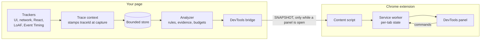

# performance-engine

[](https://github.com/ezhillragesh/performance-engine/actions/workflows/ci.yml)
[](https://www.npmjs.com/package/performance-engine)
[](./LICENSE)

**Perf Intelligence** explains why a web UI is slow. It is a frontend performance and accessibility
diagnosis toolkit that runs in the browser. It links every click and keystroke to the requests,
React renders and main-thread work it caused, and turns those causal traces into plain-language
insights with measured evidence and a suggested fix. You read them in a Chrome DevTools panel.

It has three parts:

- **`performance-engine`**: a dependency-free TypeScript library (npm) that captures and analyses
  events inside your app.
- **Perf Intelligence DevTools**: a Chrome extension (MV3) with a DevTools panel. It works on any site,
  with or without the library.
- **A demo app** that produces every detectable problem on demand, with a fixed version of each.

## Why

Profilers give you a flame chart and metrics such as INP, and leave the detective work to you. This
project records causality while it happens, which a profiler cannot reconstruct afterwards. Here is
an insight as the panel shows it (the wording comes from the `network-blocking-render` rule, and the
numbers are an example):

> **GET /api/invoices took 900ms; 6 render(s) waited for its response.** (high, confidence 0.9)
>
> **Cause:** Rendering of InvoiceTable depends on the response of /api/invoices, so the UI update is
> delayed by the full request time.
>
> **Fix:** Show pending/optimistic UI, cache or prefetch /api/invoices (stale-while-revalidate), or
> split the response so InvoiceTable can render earlier.
>
> **Evidence:** request duration 900 ms (threshold 500) · renders within 200 ms after the response: 6
> (threshold 2) · each linked to the events on the timeline.

- **Causal traces, not time windows.** Every event is stamped with the gesture that caused it at the
  moment it is captured, including across `fetch` and XHR responses. Nothing is guessed from
  timestamps later ([ADR 0001](./docs/adr/0001-stamp-trace-at-capture.md)).
- **Evidence over heuristics.** Each insight lists the measurements, thresholds and events behind it,
  and its confidence is computed from that list ([ADR 0002](./docs/adr/0002-evidence-based-confidence.md)).
- **Safe to leave on.** Bounded memory, no streaming while DevTools is closed, no PII, and
  instrumentation that never throws into your app.

## Features

| Feature | What you get | Where it runs |
|---------|--------------|---------------|
| Causal traces | Each interaction as a span tree: trigger → long tasks / requests → React commits → renders | App and injected engine |
| User actions | `trackAction('Open invoice', fn)` names traces for route changes, sockets, timers and other non-DOM work | App and injected engine |
| Automatic React instrumentation | Per-instance renders with real durations (development and profiling builds), changed props, state and context, and wasted-render detection. Compatible with React DevTools. Production builds still get render counts and causality | App and injected engine |
| Insights | 10 rules: keystroke render loop, render burst, interaction-to-render latency, network-blocking render, state thrashing, wasted renders, slow interaction, long task (with script attribution), slow component, budget exceeded | All modes (a subset in DevTools-only mode) |
| Budgets and health score | Six budgets (interaction p75, long task, component render, renders per interaction, request time, wasted %) with pass, warn and fail, and a 0 to 100 score | All modes |
| Web Vitals with attribution | LCP (element and resource), INP (input delay, processing and presentation, linked to the causal trace of that interaction), CLS (the largest shift), FCP, TTFB | All modes (attribution needs an engine) |
| Accessibility audit | One unified rule set (174 rules) checked against WCAG 2.0, 2.1 or 2.2 at A, AA or AAA, Section 508 or EN 301 549, with one finding per element and our own how-to-fix text | All modes, and as an API |
| DevTools panel | Overview, Insights, Timeline (with causal links), Traces (waterfall), Components, Network and Accessibility views. Copy an insight or the summary as Markdown, JSON export and import, a Getting-started guide | Chrome 116 or later |
| Works on any site | Per-site injection (optional host permission, enabled from the panel or the toolbar popup), or a DevTools-only layer with no engine at all | Extension |
| Production-safe | `sampleRate` (an unsampled page load installs nothing), bounded memory, no streaming while DevTools is closed, no PII, about 25 kB gzip for `initPerfEngine` + `instrumentReact` (tree-shaken) | npm package |

The features are described in [docs/ARCHITECTURE.md](./docs/ARCHITECTURE.md), and the API in
[docs/CORE_API.md](./docs/CORE_API.md).

## How it works



The engine runs inside the page: bundled by your app, or injected by the extension on sites you
enable. When no engine is present, the panel builds what it can from DevTools APIs (HAR, Long
Animation Frames, Event Timing, Web Vitals) and runs the same analyzer itself. More in
[docs/ARCHITECTURE.md](./docs/ARCHITECTURE.md).

## Quick start

### 1. In your app (best fidelity, custom rules and budgets)

```sh
npm install performance-engine
```

```ts
// src/perf.ts: import this FIRST in your entry file, before react-dom loads
import { instrumentReact, initPerfEngine } from "performance-engine";

instrumentReact(); // hooks React commits. Must run before react-dom is evaluated
export const session = initPerfEngine({
  budgets: { interactionLatencyMs: 200 },
  onInsights: (insights) => console.table(insights.map((i) => ({ severity: i.severity, issue: i.issueType, message: i.message }))),
});
```

```ts
// src/main.tsx
import "./perf";
import { createRoot } from "react-dom/client";
// ...
```

Then install the extension (below) and open DevTools → **Perf Intelligence**. The toolbar shows
**App engine**. Without React, skip `instrumentReact()`; network, interaction and main-thread analysis
work for any framework. Everything is a no-op during SSR. The engine starts its DevTools bridge
automatically. Apart from a one-time HELLO, it sends nothing until a panel is open.

You can also use the results in code or CI:

```ts
import { analyzeEvents, runA11yAudit, trackAction } from "performance-engine";
import { session } from "./perf";

session.subscribe((snapshot) => console.log(snapshot.summary.score)); // after each analysis tick
const { inp, attribution } = session.getWebVitals();                  // INP + the trace that caused it
trackAction("Open invoice", () => router.push("/invoices/42"));       // name non-DOM work as a trace
const insights = analyzeEvents(session.getEvents());                  // pure: also works on exported events
const report = runA11yAudit(document);                                // accessibility findings with WCAG ids
```

In production, `initPerfEngine({ sampleRate: 0.1 })` runs the engine on 10 % of page loads (the
others install nothing), and `subscribe()` / `getWebVitals()` let you forward results to your own
backend.

### 2. With the extension only (any site, no code changes)

1. Install the extension. Until it is listed in the Chrome Web Store, download the zip from a
   [GitHub release](https://github.com/ezhillragesh/performance-engine/releases) and unzip it, or
   clone this repository. Then open `chrome://extensions`, turn on **Developer mode**, click
   **Load unpacked**, and select the folder (`extension/` in a clone). The full user guide is
   [docs/EXTENSION.md](./docs/EXTENSION.md), and what the extension reads and stores is in
   [docs/PRIVACY.md](./docs/PRIVACY.md).
2. Open any site, then DevTools → **Perf Intelligence**. It starts in **DevTools only** mode: Web
   Vitals, network, interactions, long tasks, insights and the accessibility audit.
3. For traces, React renders and components, click **Enable on this site** in the panel or the
   toolbar popup. Chrome asks for access to that one origin, and the page reloads with the injected
   engine. You can disable it, or remove the site's access, at any time from the panel, the popup or
   Chrome.

If the page also bundles `performance-engine`, the app engine takes over and only one engine reports.

### 3. As a contributor (demo + extension from source)

```sh
git clone https://github.com/ezhillragesh/performance-engine.git
cd performance-engine
npm run setup        # installs core/ and demo/
npm run dev          # demo on the printed URL, with a mock API
```

Load `extension/` unpacked (as above), open the demo, then DevTools → **Perf Intelligence**. In the
**Scenario Lab**, press **Run** on a card and watch the insight appear with its evidence and timeline.
Toggle **Fixed version** to see it go away. `npm run e2e` runs every card in Playwright against both
the dev server and the production build. The demo's production build is a static site (its mock API
runs in a Service Worker), so it can be hosted anywhere. See [CONTRIBUTING.md](./CONTRIBUTING.md).

## Repository layout

```
core/         npm package performance-engine: trackers, trace context, React instrumentation,
              store, analyzer, budgets, DevTools bridge, accessibility audit (TypeScript)
extension/    Chrome MV3 DevTools extension (vanilla JS, no build step): devtools/ panel, popup/
  vendor/     bundles generated from core/ (checked in, never edited by hand)
  dev/        preview harness: the real panel and popup with mocked chrome.* APIs (not packaged)
demo/         React 19 + Vite showcase: Workspace (healthy) and Scenario Lab (one card per issue);
              mock/ (mock API: dev middleware + Service Worker), e2e/ (Playwright)
docs/         architecture, protocol, API, decision records
scripts/      repository checks and extension packaging
.github/      CI, release workflow, issue and PR templates
```

## Documentation

| Document | Contents |
|----------|----------|
| [docs/ARCHITECTURE.md](./docs/ARCHITECTURE.md) | Design: trace model, analysis pipeline, confidence, budgets, React instrumentation, accessibility pipeline, extension internals, security, testing |
| [docs/CORE_API.md](./docs/CORE_API.md) | Public API of `performance-engine` |
| [docs/PROTOCOL.md](./docs/PROTOCOL.md) | Page ⇄ extension message contract, engine modes, the DevTools-only layer |
| [docs/EXTENSION.md](./docs/EXTENSION.md) | Extension user guide: install, modes, site access, popup, panel views, troubleshooting |
| [docs/PRIVACY.md](./docs/PRIVACY.md) | What the extension reads, stores and never collects |
| [core/README.md](./core/README.md) | npm package README |
| [docs/adr/](./docs/adr/README.md) | Architecture Decision Records |
| [docs/README.md](./docs/README.md) | Index of all documentation |
| [CONTRIBUTING.md](./CONTRIBUTING.md) | Setup, gates, conventions, how to add rules and views, release process |
| [CHANGELOG.md](./CHANGELOG.md) | Release history |

## Development

```sh
npm run check            # all gates: core typecheck/test/build, vendor drift, extension syntax, demo lint/build
npm run check:core       # cd core && npm run typecheck && npm test && npm run check:package
npm run build:extension  # regenerate extension/vendor/ from core (required after any core change)
npm run e2e              # demo end-to-end tests (Playwright; first time: npm --prefix demo run e2e:install)
npm run bench            # analyzer and store benchmarks
npm run package:extension  # store zip in dist-extension/
```

You need Node.js `^22.22.2 || ^24.15.0 || >=26` (current LTS recommended) and Chrome 116 or later.
The per-package commands are listed in [CONTRIBUTING.md](./CONTRIBUTING.md#gates).

## Project status

The current version is 0.4.0. The engine, the extension and the demo are feature-complete for their
current scope and covered by automated tests. Until 1.0, minor versions may change the public API and
the protocol, and the [changelog](./CHANGELOG.md) notes any migration. Limitations: Chrome only, render
tracking is React-specific (other frameworks can call `trackRender()`), and render durations are real
only in React development or profiling builds. See
[Known limitations](./docs/ARCHITECTURE.md#16-known-limitations).

## License

[MIT](./LICENSE) © 2026 Ezhill Ragesh. The accessibility audit builds on eslint-plugin-a11yinspect
(MIT), IBM Equal Access accessibility-checker-engine (Apache-2.0) and axe-core (MPL-2.0). See
[THIRD_PARTY_NOTICES.md](./THIRD_PARTY_NOTICES.md).
