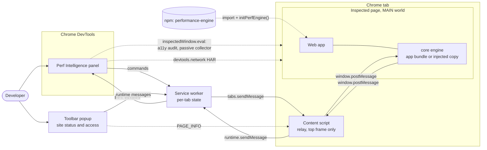
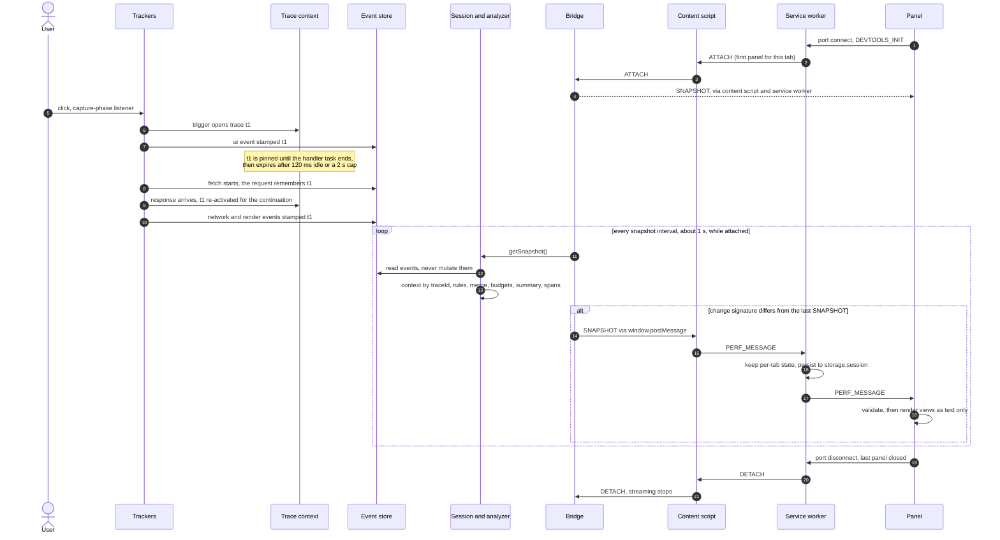
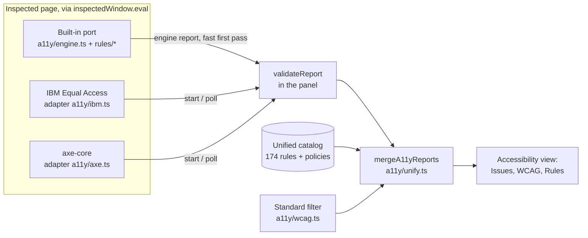
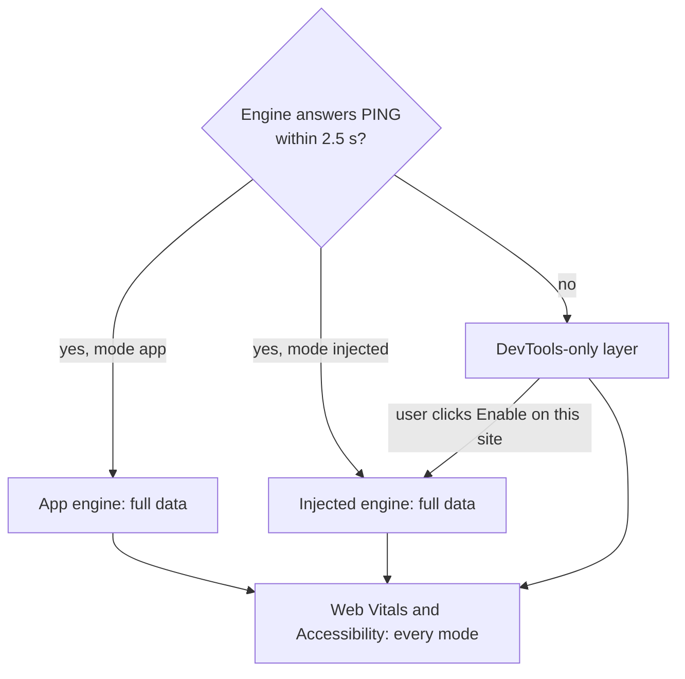

# Architecture

This is the main architecture document for **performance-engine** (the `core/` npm package), the
**Perf Intelligence DevTools** Chrome extension (`extension/`) and the **demo** app (`demo/`). It
describes the code as it is. When this document and a contract disagree, the contract wins and this
document has a bug:

| Contract | Scope |
|----------|-------|
| [`PROTOCOL.md`](./PROTOCOL.md) | Every message crossing the page / content script / service worker / panel boundary |
| [`CORE_API.md`](./CORE_API.md) | Public API of the npm package |
| [`core/types/*.ts`](../core/types) | Event, insight, budget, summary and protocol types |

Key decisions are recorded as [Architecture Decision Records](./adr/README.md) and linked from the
section they shaped.

## Contents

1. [Goals and non-goals](#1-goals-and-non-goals)
2. [System context](#2-system-context)
3. [Building blocks](#3-building-blocks)
4. [End-to-end data flow](#4-end-to-end-data-flow)
5. [Trace model and causality](#5-trace-model-and-causality)
6. [Analysis pipeline and rule contract](#6-analysis-pipeline-and-rule-contract)
7. [Insight and confidence model](#7-insight-and-confidence-model)
8. [Budgets and health score](#8-budgets-and-health-score)
9. [Memory and overhead budgets](#9-memory-and-overhead-budgets)
10. [React instrumentation and React DevTools coexistence](#10-react-instrumentation-and-react-devtools-coexistence)
11. [Accessibility audit pipeline](#11-accessibility-audit-pipeline)
12. [Extension architecture](#12-extension-architecture)
13. [Security and privacy model](#13-security-and-privacy-model)
14. [Testing strategy](#14-testing-strategy)
15. [Extension points](#15-extension-points)
16. [Known limitations](#16-known-limitations)
17. [Design evolution](#17-design-evolution)
18. [Decision records](#18-decision-records)

---

## 1. Goals and non-goals

The system answers questions that raw profilers leave to the developer:

- *Why did this click feel slow?* The handler blocked the main thread for 280 ms before the first render.
- *Which component re-renders too much?* `ResultsList` rendered 12 times per keystroke, and 9 of those renders were wasted.
- *Is the network holding up the UI?* `/api/invoices` took 900 ms, and the table rendered only after it responded.
- *Are we within budget?* Interaction p75 is 240 ms against a 200 ms budget, so the budget fails.
- *Is this page accessible?* 12 errors against WCAG 2.2 AA, each tied to one element, with a fix.

**Goals**

| Goal | How the design meets it |
|------|-------------------------|
| Explain causes, not just metrics | Events are linked into causal traces when they are captured ([§5](#5-trace-model-and-causality)). Rules produce insights with a cause, a fix and the measured evidence behind them ([§7](#7-insight-and-confidence-model)) |
| Be trustworthy | Confidence is computed from evidence, and every rule has positive and negative tests. The demo has a Healthy control that must produce zero insights |
| Never harm the host app | Instrumentation never throws into the page, and the engine's own bookkeeping errors never reach the app's `fetch`/XHR callers or `window.onerror`. Memory is bounded, nothing streams while DevTools is closed, `sampleRate` lets an unsampled page load install nothing, everything is a no-op under SSR or Node, and two engine copies on one page coordinate ([§9](#9-memory-and-overhead-budgets)) |
| Work on any site | Three engine modes: the app bundles the engine, the extension injects it per site, or a DevTools-only layer runs with no engine at all ([§12.3](#123-engine-modes-and-handoff)) |
| Keep data on the user's machine, without PII | No backend. URLs keep query parameter names only, form values are never read, and audit findings carry only a redacted element description ([§13](#13-security-and-privacy-model)) |
| Make contributions easy | The extension has no build step. Contracts live in a few files, and adding a rule takes one registry entry plus tests ([§15](#15-extension-points)) |

**Non-goals**

- Fleet or RUM analytics: there is no collector backend and no cross-session aggregation. `sampleRate`, `subscribe()` and `getWebVitals()` let an app forward data to its own backend, but the project ships none. Export to JSON is the only built-in persistence.
- Replacing the Chrome Performance panel or React DevTools: the engine produces diagnoses and links to evidence. It is not a flame chart.
- Frameworks other than React: render tracking is React-specific (fiber hook, `<Profiler>`). Other frameworks can call `trackRender()` manually. Every other tracker is framework-agnostic.
- Production-accurate render timings: React reports render durations only in development or profiling builds. Render-based insights still work in production builds, but with reduced severity and confidence ([§10](#10-react-instrumentation-and-react-devtools-coexistence)).
- Complete accessibility conformance testing: automated checks find a subset of WCAG issues, so the audit complements manual testing.

## 2. System context



| Subsystem | Tech | Role | Ships as |
|-----------|------|------|----------|
| [`core/`](../core) | TypeScript, ESM, no runtime dependencies, no React dependency | Captures events, links them into traces, analyses them, publishes to DevTools, audits accessibility | npm package `performance-engine` (`dist/`), plus bundles generated into `extension/vendor/` |
| [`extension/`](../extension) | Chrome MV3, vanilla JS, no build step, no npm dependencies | Moves data per tab and renders the DevTools panel. Can inject the engine per site | Unpacked folder or store zip (`node scripts/package-extension.mjs`) |
| [`demo/`](../demo) | React 19 + Vite | Showcase app. Generates every detectable problem on demand, with a fixed version of each | Dev server (`npm run dev`) or a static build that runs on any static host (mock API in a Service Worker) |

The three subsystems are independent npm projects (no workspaces). The demo imports core from source
under its package name: `import … from 'performance-engine'` resolves to `../core/index.ts` through a
Vite alias and a tsconfig `paths` entry (Vite's `server.fs.allow: ['..']` is still needed). The
extension consumes core only through the generated bundles in `extension/vendor/`.

## 3. Building blocks

### 3.1 Core (`core/`)

```
core/
├─ index.ts, session.ts        public API, session lifecycle (initPerfEngine)
├─ types/                      events, insights, protocol contracts
├─ tracker/                    ui · network · render · performance (LoAF, Event Timing) · webVitals · dom helpers · ids · clock
├─ trace/traceContext.ts       causal trace model (active trace, pinning, async hand-off, runDetached)
├─ trace/actions.ts            user actions: startAction / trackAction name traces for non-DOM work
├─ react/instrumentReact.ts    automatic React fiber instrumentation, RDT-compatible hook
├─ logger/store.ts             bounded, timestamp-ordered event store (pause, drop counters)
├─ analyzer/                   context · rules/* · engine (merge) · budgets · summary · traces · explain
├─ bridge/devtoolsBridge.ts    page side of the DevTools protocol
├─ runtime/engineGlobal.ts     cross-copy registry for the app/injected handoff
├─ a11y/                       accessibility audit: built-in rules, IBM and axe adapters, unified catalog, merge
├─ inject/                     entry points of the extension bundles
├─ scripts/                    build-extension.mjs, build-a11y.mjs (esbuild, writes extension/vendor/), check-package.mjs
└─ tests/  a11y/__tests__/  bench/
```

| Component | Responsibility | Key invariant |
|-----------|----------------|---------------|
| Trackers (`tracker/*`) | Turn DOM events, `fetch`/XHR, React commits, Long Animation Frames and Event Timing entries into `TrackedEvent`s | Read the active `traceId` when the event is created. Never throw into the page |
| Trace context (`trace/traceContext.ts`) | Decide which trace is active at any moment | Traces are never inferred later from timestamps ([ADR 0001](./adr/0001-stamp-trace-at-capture.md)) |
| User actions (`trace/actions.ts`) | `startAction(name, { newTrace })` and `trackAction(name, fn)` open or join a trace for work that has no DOM event (route changes, socket messages, timers). The trace summary carries `action`, and the action is recorded as a UI event with `eventType: "action"` | Recorded only while a sampled session runs. Otherwise the handle just runs the code |
| Web Vitals tracker (`tracker/webVitals.ts`) | LCP, INP, CLS, FCP and TTFB with attribution: the LCP element and URL, the largest CLS shift, the INP phases and the `traceId` of the INP interaction's causal trace. Exposed as `session.getWebVitals()` and as snapshot `vitals` | Lives outside the store and for the page's lifetime (not reset by `clear()`) |
| Store (`logger/store.ts`) | Hold the most recent events in timestamp order | Bounded (clamped to 100–50,000). Events are never mutated after they are pushed, and events with a non-finite timestamp are rejected. A stale (stopped) session must never touch the shared store ([ADR 0003](./adr/0003-bounded-in-memory-store.md)) |
| Analyzer (`analyzer/*`) | A pure function from events to insights, budgets, a summary and trace summaries | Rules scope to a trace. Confidence comes from evidence ([ADR 0002](./adr/0002-evidence-based-confidence.md)) |
| Session (`session.ts`) | Wire trackers, the analysis tick, subscribers, budgets, sampling and the bridge | Getters may re-analyse but never notify subscribers synchronously. A stopped session's handle can no longer clear or pause the live one |
| Bridge (`bridge/devtoolsBridge.ts`) | Speak the page side of [`PROTOCOL.md`](./PROTOCOL.md) | Streams only while a panel is attached ([ADR 0005](./adr/0005-attach-gated-streaming.md)) |
| Engine registry (`runtime/engineGlobal.ts`) | Coordinate two copies of core on one page | The app engine wins ([ADR 0008](./adr/0008-engine-modes-and-app-wins-handoff.md)) |
| React instrumentation (`react/instrumentReact.ts`) | Record per-instance renders from React commits | Stays compatible with React DevTools ([ADR 0004](./adr/0004-rdt-compatible-react-hook.md)) |
| Accessibility audit (`a11y/*`) | Audit the live DOM and merge three engines into one rule set | No PII. Engines are never named in the UI ([ADR 0007](./adr/0007-unified-a11y-rule-set.md)) |

`core/index.ts` re-exports only named, side-effect-free API (`package.json` sets `"sideEffects": false`).
Importing the package does nothing by itself, and bundlers keep only what is used. Measured by
`npm run check:package` with esbuild (minified / gzip): `analyzeEvents` only 34.0 / 11.2 kB,
`initPerfEngine` + `instrumentReact` 73.8 / 25.2 kB, `runA11yAudit` 110.5 / 30.6 kB, bare import 0.

**The npm package** is ESM-only (MIT, Node 18 or later for consumers) and ships `dist/`, `README.md` and
`LICENSE`. `npm run build` cleans `dist/` and copies `THIRD_PARTY_NOTICES.md` into it. `prepack` builds,
and `prepublishOnly` runs the typecheck, the tests and `check:package`. `check:package` packs the
tarball and installs it like a consumer would: import in Node without a DOM; `tsc` under the `bundler`,
`node16` and `nodenext` resolution modes; esbuild tree-shaking.

### 3.2 Generated bundles (`extension/vendor/`)

`cd core && npm run build:extension` generates the following files, which are checked in so the extension loads unpacked
([ADR 0006](./adr/0006-no-build-extension-with-vendored-bundles.md)). CI fails if they drift from core.

| File | Entry | Format | Used by |
|------|-------|--------|---------|
| `perf-engine.inject.js` | `core/inject/entry.ts` | IIFE | Injected into the page MAIN world at `document_start` on sites the user enabled |
| `perf-analyzer.mjs` | `core/inject/analyzer.ts` | ESM | The panel, to analyse DevTools-only data |
| `a11y-audit.js` | `core/a11y/browser.ts` | IIFE | `inspectedWindow.eval` (installs `window.__PERF_INTEL_A11Y__`) |
| `a11y-rules.mjs` | `core/inject/a11yRules.ts` | ESM | The panel: unified catalog, WCAG table, merge, engine loaders (DOM-free) |
| `ibm-ace.js` (+ `ibm-ace.LICENSE.txt`) | `accessibility-checker-engine` (pinned) | unchanged copy | Evaluated wrapped, on demand |
| `axe.min.js` | `axe-core` (pinned) | unchanged copy | Evaluated wrapped, on demand |
| `../THIRD_PARTY_NOTICES.txt` | `THIRD_PARTY_NOTICES.md` | copy | Panel footer, "Open-source credits" |

### 3.3 Extension (`extension/`)

| Component | File(s) | Responsibility |
|-----------|---------|----------------|
| Relay content script | `contentScript.js` (classic, top frame, `document_start`) | Forwards `source: "perf-engine"` page messages to the service worker and panel commands back to the page. Detaches the page when orphaned by an extension reload |
| Service worker | `background.js` | Routes messages by `tabId`, keeps per-tab state (in memory and in `chrome.storage.session`), gates streaming with ATTACH/DETACH, registers and unregisters per-site injection |
| DevTools page | `devtools/devtools.{html,js}` | Creates the "Perf Intelligence" panel |
| Panel shell | `devtools/panel/main.js`, `state.js`, `connection.js` | View registry (`VIEWS`), toolbar, store, port connection with auto-reconnect, mode detection, first-run Getting-started guide (`?`) |
| Validation | `devtools/panel/validate.js` | Caps and drops malformed page payloads. Kept in sync with `core/types` |
| Views | `devtools/panel/views/*.js` | Overview, Insights, Timeline, Traces, Components, Network, Accessibility, plus the Budgets and Site access UI |
| Reports | `devtools/panel/report.js` | "Copy as Markdown" for an insight and "Copy summary" for the Overview. URLs are reduced to origin and path |
| DevTools-only layer | `devtools/panel/devtoolsLayer/*` | HAR network events, a passive `PerformanceObserver` collector, synthetic snapshots analysed with `perf-analyzer.mjs` |
| Toolbar popup | `popup/popup.{html,js,css}` (classic script, no extra permissions) | Per-site status, version, React detection, score and counts, and Enable / Disable / Remove access for the current site |
| Preview harness | `dev/preview.html`, `popup-preview.html`, `mock-chrome.js`, `mock-popup.js`, `fixture.js`, `a11y-fixture.html` | Runs the real panel and popup in a normal tab with mocked `chrome.*` APIs and generated data. Not packaged |
| Packaging | `scripts/package-extension.mjs` (repo root) | Verifies every path referenced by the manifest and the HTML pages, then writes `dist-extension/perf-intelligence-devtools-<version>.zip` without `dev/` |

### 3.4 Demo (`demo/`)

| Area | Purpose |
|------|---------|
| `src/perf.ts` | Engine bootstrap, the first import of `main.tsx`, so `instrumentReact()` runs before `react-dom` loads. Imports `performance-engine` (aliased to `../core/index.ts`) |
| Workspace tab (`src/workspace/`) | A realistic inbox and task UI. This is the well-behaved control surface and must stay free of jank. Pages stay mounted, and navigation is wrapped in `trackAction('Open …', { newTrace: true })` |
| Scenario Lab (`src/scenarios/`) | One card per issue type, each with a **Fixed version** that must not produce it, plus a Healthy control that must produce zero insights and an Accessibility card. Deliberate problems live only here and are marked `INTENTIONAL` |
| Mock API (`mock/api.ts`) | One deterministic handler for `api/messages`, `api/invoices`, `api/slow?ms=` and `api/error`, with two transports. In dev it is Vite middleware (`server/mockApi.ts`). The production build ships a Service Worker (`dist/mock-api-sw.js`, built from `mock/sw.ts`) that `src/lib/api.ts` registers before the first render. Either way the page makes real `fetch`/XHR requests with real Resource Timing |
| Production build | React's profiling build (`react-dom/profiling`), so render durations are real, and esbuild `keepNames`, so component names stay readable. `DEMO_REACT_PROFILING=0` ships plain production React. `DEMO_BASE` sets the base path (for example, GitHub Pages). `vite preview` behaves like a static host |
| End-to-end tests (`e2e/`, `playwright.config.ts`) | `npm run e2e` (Playwright, Chromium): every scenario and its fixed version, the Workspace, tabs and console checks, against both the dev server and the production build. Starts its own servers on ports 5175 and 5176 |

## 4. End-to-end data flow

```
trackers (ui / network / render / longtask+LoAF / event-timing / actions)
  -> trace context stamps traceId AT CAPTURE -> bounded store (2000)
  -> buildAnalysisContext (group by traceId; time-window fallback only for untagged events)
  -> rules (analyzer/rules/*) -> Insight{id, evidence[], confidence from evidence} -> merge
  -> budgets + summary + trace summaries (spans with parentId = causal chain)
  -> session (core/session.ts) -> devtoolsBridge (postMessage, only while a panel is ATTACHed)
     (+ web-vitals tracker -> snapshot.vitals, outside the store, for the page's lifetime)
  -> contentScript.js -> background.js (per-tab state, chrome.storage.session) -> panel
```

A click that triggers a request, which in turn re-renders a table:



The session also runs its own analysis tick (`analysisIntervalMs`, default 2000 ms). When the store
changed, the tick notifies `subscribe()` listeners and `onInsights` through `runDetached`, so that UI
rendering engine stats is never blamed on the user's click. Snapshots and `onInsights` always carry
the **full** insight list, never a "fresh" subset.

## 5. Trace model and causality

A **trace** is one user gesture and everything it caused ([ADR 0001](./adr/0001-stamp-trace-at-capture.md)).

```
pointerdown ─┐ (a click within 500 ms joins the same trace)
click ───────┴─► TRACE OPEN
   │  synchronous handler ........ pinned until the triggering task ends
   │  microtasks, next frames .... active until 120 ms idle (hard cap 2 s per segment)
   │  fetch('/api/x') ............ the request remembers the traceId
   ▼
response arrives ─► trace re-activated for the continuation ─► renders stamped with it
```

| Rule | Detail (`core/trace/traceContext.ts`) |
|------|----------------------------------------|
| Tag at capture | Every event reads `getActiveTraceId()` when it is created. Analysis never mutates or re-tags events. The time-window fallback (`DEFAULT_INTERACTION_WINDOW_MS` = 300) applies only to untagged legacy events, and each untagged event joins at most one window |
| Triggers | `click`, `dblclick`, `keydown`, `input`, `change`, `submit`, `pointerdown` (`TRIGGER_EVENT_TYPES`), plus user actions (UI events with `eventType: "action"`) |
| Gesture joining | `keydown→input`, `click→change/submit`, `click/pointerdown→dblclick` and `keydown→click` (Enter/Space) join within `GESTURE_JOIN_MS` = 50 ms. `pointerdown→click` joins within `POINTER_JOIN_MS` = 500 ms |
| Idle expiry | `TRACE_IDLE_MS` = 120 ms without attributed work, or `TRACE_MAX_SEGMENT_MS` = 2000 ms per active segment. Expiry is evaluated lazily against the clock |
| Slow handlers keep their trace | The trace is **pinned** until a zero-delay timer fires after the triggering task, so 300 ms of synchronous work before `setState` does not expire the trace before the render it causes |
| Async hand-off | `fetch`/XHR capture the `traceId` at request start and re-activate it when the response arrives. If a *newer* interaction is live, the response only borrows its trace for the synchronous continuation, then restores the live one |
| Detached work | `runDetached(fn)` hides the active trace while `fn` and the microtasks it schedules run. Engine and tooling work (tick notifications) uses it |
| Explicit attribution | `runInTrace(traceId, fn)` attributes work to a known trace |
| User actions | `startAction(name, { newTrace })` / `trackAction(name, fn)` (`trace/actions.ts`) open a trace for non-DOM work, or join the active one unless `newTrace: true`. Work inside the action is stamped like a gesture's, and the trace summary carries `action` |
| Bounded history | The last 64 trace records are kept (ring buffer) |

**Causal spans.** `buildTraceSummaries` (`analyzer/traces.ts`) turns each trace into a span tree.
`longtask` and `network` spans hang off the interaction span. A `commit` span hangs off the latest
request in the trace whose response ended before that commit, or off the interaction when there is
none. `render` spans hang off their commit. `parentId` is the causal chain that the Traces waterfall
and the Timeline's causal links draw. Render spans are capped at 200 per trace.

## 6. Analysis pipeline and rule contract

```
events ─► buildAnalysisContext ─► rules ─► dedupe by id ─► interval-union merge ─► sort
          (group by traceId,       (10, in          (strongest        (same issueType +
           render commits,          registry         wins)             source, earliest id)
           per-instance)            order)
       └─► evaluateBudgets ─► computeSummary (score, top lists) ─► buildTraceSummaries (spans)
```

- **Context** (`analyzer/context.ts`): sorts events, groups them by `traceId`, builds render commits
  and chains, and keys render history by `instanceId`, so 24 list rows count as 24 instances and not
  as one thrashing component. Wasted renders come from the instrumentation's `wasted` flag, or from
  equal props hashes against the same instance's previous render. There is no zero-duration
  heuristic.
- **Render cost**: `RenderEvent.timestamp` is the render *start*. `durationMs` is React
  `actualDuration` and includes children, so costs are summed from `selfDurationMs` and never from
  `durationMs` across nested components.
- **Production React builds**: renders without timing data still count, but render-based insights
  (render burst, keystroke loop, state thrashing, wasted renders) built only from such renders are
  capped at `medium`, get lower confidence and an explanatory cause, and carry
  `metadata.renderCostUnknown: true`.
- **Engine** (`analyzer/engine.ts`): runs each rule inside a `try`/`catch`, so a throwing custom rule
  is reported through `onRuleError` and skipped. It normalises custom-rule output, dedupes by `id`
  (higher severity, then confidence, then impact wins) and merges overlapping windows of the same
  `issueType` and `source` into one insight. The merged insight keeps the earliest member's `id` and
  the strongest member's content. The result does not depend on rule order.
- **Complexity**: O(n log n). `tests/perf-budget.test.ts` keeps it there ([§9](#9-memory-and-overhead-budgets)).

**Rule contract** (`analyzer/rules/shared.ts`):

```ts
interface AnalysisRule {
  name: string;
  run(context: AnalysisContext, options: RuleOptions): Insight[];
}
interface RuleOptions {
  budgets: PerformanceBudgets;
  interactionWindowMs: number;
  priorInsights: readonly Insight[]; // produced by rules that ran earlier in this pass
}
```

Rules scope to a trace (`context.traces`), never to the global `context.events`. The default set
(`analyzer/rules/index.ts`) runs in this order:

| # | Rule (`IssueType`) | Category | Detects | Key threshold |
|---|--------------------|----------|---------|---------------|
| 1 | `keystroke-render-loop` | rendering | Typing that causes many renders per keystroke | ≥ 3 renders within 120 ms of the keystroke. Runs before the render-burst rule, so a keystroke is reported once, as the more specific insight |
| 2 | `interaction-induced-render-burst` | rendering | A click cascading through many components | ≥ 6 renders within 160 ms |
| 3 | `interaction-render-latency` | interaction | Slow time from trigger to first render (synchronous work or a blocking request) | ≥ 50 ms |
| 4 | `network-blocking-render` | network | UI waiting on a slow request | Request ≥ 500 ms, and ≥ 2 renders within 200 ms **after** the response |
| 5 | `state-thrashing` | rendering | State flipping back and forth | ≥ 4 commits from one cause, with gaps ≤ 80 ms |
| 6 | `wasted-render` | rendering | Re-renders with no input change | ≥ 3 wasted renders of one instance |
| 7 | `slow-interaction` | interaction | Browser-measured latency over budget | `interactionLatencyMs` budget |
| 8 | `long-task` | main-thread | Main thread blocked, with script attribution | `longTaskMs` budget, blocking time > 0 |
| 9 | `slow-component` | rendering | A single component render longer than a frame | `componentRenderMs` budget |
| 10 | `budget-exceeded` | budget | Any failing budget that no earlier insight explains | Must run last, because it reads `priorInsights` |

The thresholds above are each rule's main trigger condition. Rules add further gating to avoid false
positives (for example, which targets count as typing, or which renders a burst counts). The rule
sources in `analyzer/rules/*.ts` and their positive and negative tests are authoritative.

## 7. Insight and confidence model

Every `Insight` (`core/types/insights.ts`) has the following fields
([ADR 0002](./adr/0002-evidence-based-confidence.md)):

| Field | Meaning |
|-------|---------|
| `id` | Stable identity, anchored on the trigger or first event, so it does not change as the window grows. Used for dedupe, merge and panel selection |
| `issueType`, `category` | One of the closed `IssueType` union. `rendering`, `network`, `main-thread`, `interaction` or `budget` |
| `severity` | From the measured magnitude. Latency uses INP-style bands: under 100 ms low, under 200 ms medium, under 500 ms high, 500 ms and above critical. Ratio-based rules use 1×, 2× and 4× the threshold. Render cascades that cost less than one frame (16 ms) are capped at medium, and so are render insights without timing data (production React builds) |
| `message`, `cause`, `possibleFix` | Plain language |
| `evidence[]` | Measured facts: `kind` (measurement, correlation, budget, heuristic), `label`, `value` + `unit`, the `threshold` it was compared with, the `eventIds` behind it (highlighted in the Timeline), and a `weight` |
| `confidence` | `1 − Π(1 − weightᵢ)` (noisy-OR over evidence weights), capped at 0.98. Weights grow with how far a value exceeds its threshold (`scaledWeight`) |
| `impact` | `estimatedDelayMs` and `renderCostMs` from measured durations |
| `traceId`, `metadata` | The trace the insight came from. Metadata holds window bounds, affected components, `mergedCount` and similar |

`explainInsight(insight)` formats the same data as a human-readable string.

## 8. Budgets and health score

| Budget (`PerformanceBudgets`) | Default | Measured as |
|-------------------------------|---------|-------------|
| `interactionLatencyMs` | 200 ms | p75 of Event Timing samples (INP-style) |
| `longTaskMs` | 50 ms | Longest blocking main-thread task |
| `componentRenderMs` | 16 ms | Slowest single render, self time |
| `rendersPerInteraction` | 25 | Most renders in one trace |
| `networkRequestMs` | 1000 ms | Slowest request |
| `wastedRenderPct` | 30 % | Share of renders that were wasted (needs at least 20 samples) |

The status is `pass`, `warn` (at 80 % of the limit or more, `BUDGET_WARN_RATIO`), `fail` or `no-data`.
Budgets can be set in code (`initPerfEngine({ budgets })`), at runtime (`session.setBudgets`) or from
the panel's budgets editor (`SET_BUDGETS`; the panel saves them in `chrome.storage.local` and re-applies them).

**Health score** (`analyzer/summary.ts`, 0 to 100): starts at 100. A failing budget costs 12 points
and a warning costs 4. Insights cost 10 (critical), 6 (high), 3 (medium) or 1 (low), capped at 50 in
total, so many minor insights cannot zero the score. The grade is **good** at 90 or more,
**needs improvement** at 50 or more, and **poor** below 50.

## 9. Memory and overhead budgets

| Resource | Bound | Where |
|----------|-------|-------|
| Event store | 2000 events by default (`maxEvents`, clamped to 100–50,000; a non-finite value falls back to the default). When full, the oldest 25 % are dropped at once to amortise the cost. Trimmed and paused-drop counts are reported as `droppedEvents` | `logger/store.ts` ([ADR 0003](./adr/0003-bounded-in-memory-store.md)) |
| Sampling | `sampleRate` (0 to 1, decided once per `initPerfEngine` call). An unsampled session installs no listeners, observers or patches, records nothing and reports `sampled: false` | `session.ts` |
| Trace records | Last 64 | `trace/traceContext.ts` |
| Snapshot | 1500 most recent events, 100 most recent traces, 200 render spans per trace | `session.ts`, `analyzer/traces.ts` |
| Streaming | None while no panel is attached. While attached, at most one `SNAPSHOT` per interval (default 1000 ms, minimum 100), and only when the change signature differs | `bridge/devtoolsBridge.ts` ([ADR 0005](./adr/0005-attach-gated-streaming.md)) |
| Analysis | Lazy: re-runs only when the store version or budgets changed. Timer intervals are sanitised, so a non-finite value cannot busy-loop | `session.ts` |
| Long-task attribution | At most 5 scripts per frame | `tracker/performanceTracker.ts` |
| Web Vitals | One record per page load (not part of the store), kept for the page's lifetime | `tracker/webVitals.ts` |
| Service worker persistence | 1000 events and 3 M characters per tab, 8 M characters across all tabs (evicting the least recently updated tab's persisted copy). `storage.session` holds 10 MB | `extension/background.js` |
| DevTools-only collector | 1500 entries per ring buffer, polled about every 1.5 s | `devtoolsLayer/collector.js` |
| Accessibility audit | Built-in engine: 500 ms time budget, 1000 findings. Every rule runs inside `try`/`catch` | `a11y/engine.ts` |

**Speed guards** (tests that fail the build):

- `core/tests/perf-budget.test.ts`: `analyzeEvents` over 2000 synthetic events must take less than **50 ms**
  (median of 5 runs, about 11 ms locally). 20,000 events must cost well under 40× the time of 2000,
  which keeps the pipeline near-linear.
- `core/a11y/__tests__/perf.test.ts`: auditing 5000 elements in jsdom must take less than **600 ms**
  (median, about 250 ms locally), plus a machine-independent linear-scaling check.

`npm run bench` (vitest bench) measures `analyzeEvents` at 2k, 10k and 50k events (about 12, 55 and
260 ms), context build, summary, trace summaries, a React commit walk over 5000 fibers (about 4 ms)
and store throughput.

**Size.** The npm tarball holds 193 files (about 461 kB packed). What an app ships depends on what it
imports, as measured by `check:package` ([§3.1](#31-core-core)). Generated extension bundles are
printed by `build:extension` (for example `perf-engine.inject.js` about 68 KiB and
`perf-analyzer.mjs` about 40 KiB).

## 10. React instrumentation and React DevTools coexistence

`instrumentReact()` (`react/instrumentReact.ts`) listens to every React commit through
`__REACT_DEVTOOLS_GLOBAL_HOOK__`, the hook React DevTools uses, so components need no code changes.
For each component that actually rendered in a commit, it records:

| Field | Meaning |
|-------|---------|
| `componentName`, `instanceId` | Display name and a stable per-instance id |
| `commitId`, `phase` | Which commit. `mount`, `update` or `nested-update` |
| `durationMs`, `selfDurationMs` | Real render time including children, and self only (React development or profiling builds) |
| `changedProps`, `stateChanged`, `contextChanged` | Why the component rendered |
| `wasted` | Re-rendered with no prop, state or context change, only because its parent rendered |
| `parentComponent` | Nearest composite ancestor |

The walk skips bailed-out subtrees, honours `ignore` patterns (the demo ignores `EngineStatus` to
avoid a feedback loop) and swallows every error. It must run **before `react-dom` loads**, because
React registers with the hook when it is first evaluated. Alternatives are `createProfilerOnRender()`
for `<Profiler onRender>` and manual `trackRender()`.

**Coexistence** ([ADR 0004](./adr/0004-rdt-compatible-react-hook.md)):

- If React DevTools (the extension or `react-devtools-core`) installed its hook first,
  `instrumentReact()` chains its `onCommitFiberRoot`.
- If there is no hook yet, it installs an RDT-compatible hook (`renderers`, `rendererInterfaces`,
  `backends`, `sub/on/off/emit`, `inject` emitting `"renderer"`, `getFiberRoots`, commit forwarding)
  as a configurable accessor.
- It **yields** to a real React DevTools that installs later. While the hook is still ours and *no
  renderer has registered*, a window-scoped `hasOwnProperty` shim reports the key as absent, so React
  DevTools' `installHook` proceeds. The new hook is then re-chained (by microtask, by setter, or lazily
  from `getReactInstrumentationStatus()`). Once React has registered with our hook, it never yields,
  because nothing may be lost.
- With two core copies on one page, both commit wrappers can stay chained, but only the copy that owns
  the registered session records renders (`isOwnerCopy`). Renders are never double counted.
- `core/tests/rdtCoexistence.test.ts` checks this against the real `react-devtools-core` backend.
- `getReactInstrumentationStatus()` returns `"not-installed"`, `"waiting"` or `"active"`. HELLO

**Production builds.** Plain production React reports no render durations, so renders are recorded
with `durationMs` 0. Render counts, wasted flags and causality still work, `slow-component` cannot
fire, and render-based insights are capped and marked `renderCostUnknown` ([§6](#6-analysis-pipeline-and-rule-contract)).
The panel shows a production-React note in Components and on the Overview. React's profiling build
(`react-dom/profiling`), which the demo's production build uses, reports real durations.
  `config.react` becomes true only once a renderer registered or a commit was observed.

## 11. Accessibility audit pipeline

The panel and the demo show **one unified rule set**: 174 rules in `core/a11y/catalog/unified.ts`,
each with our own title, description and how-to-fix, its WCAG success criteria (level and version)
and tags (best practice, Section 508, EN 301 549). Three engines evaluate it internally, and **the UI
never names them**. Only `THIRD_PARTY_NOTICES` (the panel footer's "Open-source credits") does
([ADR 0007](./adr/0007-unified-a11y-rule-set.md)).



| Engine (internal) | Source ids | Ships as | Role |
|-------------------|------------|----------|------|
| Runtime port of BarrierBreak eslint-plugin-a11yinspect (MIT), `a11y/engine.ts` + `rules/*` | 89 rules, 227 messageIds | Inside `vendor/a11y-audit.js` | Fast first pass: one element walk with per-tag dispatch, computed accessible names, real visibility |
| IBM Equal Access `accessibility-checker-engine` (Apache-2.0), pinned exact | ACT-harmonised rules | `vendor/ibm-ace.js`, the official `ace.js` **unchanged** | Contrast, focus, target size, same-origin frames |
| Deque `axe-core` (MPL-2.0), pinned exact | ACT rules | `vendor/axe.min.js`, **unchanged** | Contrast, ARIA, shadow DOM |

**Pipeline.**

1. The built-in engine runs synchronously and its results show at once. axe and then IBM run through
   `start` / `poll` / `cancel` on `window.__PERF_INTEL_A11Y__`, because `inspectedWindow.eval` cannot
   await promises. The IBM scan is synchronous inside the page, so Cancel discards its result but
   cannot interrupt it.
2. Engines load **wrapped** (`a11y/loaders.ts`): `ace.js` installs `window.__PERF_INTEL_ACE__` and axe
   installs `window.__PERF_INTEL_AXE__`. Page-owned `window.ace`, `window.axe` and AMD `define` are
   never clobbered.
3. Each adapter maps engine results to engine-level findings (`kind`: error, warning or **review**,
   "needs review", a possible failure a person must confirm), records each element's identity, and
   regenerates a redacted snippet from the live element.
4. `mergeA11yReports` (DOM-free, so the panel runs it) maps every source id to its unified rule and
   **dedupes by element identity, never by selector strings**. Every adapter records `node` (a
   per-page key from `sourceUtil.nodeKey`), `pos` (a composed-tree position giving document order
   and ancestry without a DOM) and one canonical `selector` (our `uniqueSelector`, or our
   `canonicalXPath` for shadow or frame nodes; never axe's `host >>> inner`). Duplicates then collapse
   through the policy tables in `catalog/unified.ts`:

   | Policy | Collapses |
   |--------|-----------|
   | `PAGE_RULES` | Page-level rules on the top document's html, head or body become one page finding |
   | `SUBSUMED_BY` | A rule that another rule on the same element covers (for example, a placeholder-only label folds into the label rule) |
   | `NESTED_POLICY` | The same rule on an element and its descendant: keep the outer element (button-name, link-name, region, aria-hidden-focus) or the inner one (image-alt) |
   | `NESTED_INTO` | An unlabelled icon inside an unnamed button or link folds into the control |
   | `REFINE`, `CHECK_REFINE` | Source rules broader than one unified rule, refined by element shape or by check id |

   The merged kind is the most severe (error > review > warning), as is the impact. Findings are
   ordered by impact, kind, rule (catalog order) and then document order. Hidden
   `sources: [{ engine, rule, check, kind }]` keep the origin for exports and debugging, and are never
   rendered. Unmapped source ids (after an engine upgrade) fall back to the rule "other".
5. The **standard** (`a11y/wcag.ts`) filters the result: WCAG 2.0, 2.1 or 2.2 at level A, AA or AAA,
   or the Section 508 (WCAG 2.0 AA) and EN 301 549 (WCAG 2.1 AA) profiles, plus "best practices" and
   "needs review" toggles. Engines are also run for the standard (axe `runOnly` tags, an IBM ruleset).
   `criteriaCoverage` and `rulesCoverage` feed the panel's WCAG and Rules sub-views.

**Audit rules of conduct.** The audit reads text with `textContent` only (never `innerText`, which
forces layout) and never mutates the audited DOM, except for the highlight overlay marked with
`A11Y_IGNORE_ATTR`. It never throws: every rule runs inside `try`/`catch`, under time and findings
budgets. `a11y/browser.ts` is the only file with side effects and is excluded from the npm build.

**APIs for apps and CI:** `runA11yAudit(root?)`, `runIbmAudit(ace, root?, opts)`,
`runAxeAudit(axe, root?, opts)` and `mergeA11yReports(reports, { standard })` (see [`CORE_API.md`](./CORE_API.md)).

## 12. Extension architecture

### 12.1 Processes and message paths

| Context | Lifetime | Holds |
|---------|----------|-------|
| Page MAIN world | Page load | The engine (app or injected), trackers and store. The bridge talks via `window.postMessage` |
| Content script (isolated world) | Page load, top frame only | Nothing. It is a stateless relay that checks `source` and `type` |
| Service worker | Terminated by Chrome whenever it is idle | `PORTS` (tabId → panel ports), `TABS` (tabId → latest HELLO, SNAPSHOT, URL) mirrored to `chrome.storage.session` |
| DevTools panel | While DevTools is open for the tab | The view store, a validated copy of the data, the DevTools-only layer, the accessibility audit state |

Panel commands travel panel → service worker → `chrome.tabs.sendMessage(tabId, …, { frameId: 0 })` →
content script → `window.postMessage` → bridge. Only top-frame messages are accepted. The message
catalogue, including injection control (`INJECTION_STATUS_REQUEST`, `ENABLE_INJECTION`,
`DISABLE_INJECTION`), is in [`PROTOCOL.md`](./PROTOCOL.md).

### 12.2 Per-tab state and service-worker death

An MV3 service worker can die at any time. `background.js`:

- persists each tab's latest HELLO and SNAPSHOT (shrunk to the per-tab budget) to `chrome.storage.session`,
  debounced by 1.5 s, under a global LRU character budget ([§9](#9-memory-and-overhead-budgets)), and
  restores it lazily on the next message for that tab;
- serialises async handling per tab, so a restore and a new message never race;
- resets a tab's state on navigation (`status: "loading"` with a URL change), on a new `sessionId` in
  HELLO, and when the tab closes;
- sends DETACH when a SNAPSHOT arrives for a tab with no connected panel (a stream orphaned by a
- never keeps full URLs with query strings in session storage.
  service-worker restart). An orphaned content script (after an extension reload or update) posts
  DETACH to the page itself.

The panel reconnects its port automatically and re-sends `DEVTOOLS_INIT`.

### 12.3 Engine modes and handoff



| Mode | How it starts | Data |
|------|---------------|------|
| **App engine** | The app imports `performance-engine` and calls `instrumentReact()` and `initPerfEngine()` | Everything, plus custom budgets and rules in code |
| **Injected engine** | The user clicks **Enable on this site** (in the panel or the toolbar popup). The panel requests the optional host permission for that origin (a user gesture), and the service worker registers `vendor/perf-engine.inject.js` as a MAIN-world content script at `document_start` for that origin only, then reloads the tab. An Enable click is remembered for 5 minutes, so a grant made another way still activates injection. Disabling can also remove site access, and reloads the tab only when needed | Everything (traces, React renders, components), with no code changes |
| **DevTools only** | Automatic when no engine answers | Network from `chrome.devtools.network` (HAR). A passive collector installed through `inspectedWindow.eval` gathers Long Animation Frames, Event Timing, LCP, CLS, paint and navigation entries. `perf-analyzer.mjs` turns these into insights (slow interactions, long tasks, slow or failed requests). Traces, Components and the Renders lane show an "Enable on this site" prompt |

Web Vitals (LCP, INP, CLS, FCP, TTFB) and the Accessibility audit work in every mode, because the
panel can collect them through DevTools APIs. When an engine is present, its own vitals (snapshot
`vitals`, with attribution) are preferred, and the Overview links the INP interaction to its causal
trace. Pages where extensions cannot run (the Chrome Web Store, `chrome://` pages) show a clear
"can't run here" banner instead of a mode. A site that is enabled but has no engine yet offers a
Reload button.

**Handoff** ([ADR 0008](./adr/0008-engine-modes-and-app-wins-handoff.md)): every core copy registers
on `globalThis.__PERF_ENGINE_GLOBAL__ = { kind, sessionId, stop, copy, engineVersion }`.
`initPerfEngine` stops a session registered by *another* copy first. Stopping uninstalls that copy
completely: listeners, observers, the bridge, and the `fetch`/XHR patches, which become pass-throughs
when a later wrapper prevents unhooking. The injected bundle does nothing if an `"app"` engine is
already registered. In injected mode the bridge stays silent until `DOMContentLoaded`: no HELLO, and
commands are ignored. An app engine that starts during parsing therefore wins before the panel sees
the injected session. Module-level state is per copy, so nothing assumes a singleton across bundles.

### 12.4 ATTACH-gated streaming

The background sends ATTACH when a tab's first panel port connects and DETACH when its last one
disconnects. The bridge answers PING and HELLO at all times, but streams SNAPSHOTs only between
ATTACH and DETACH ([ADR 0005](./adr/0005-attach-gated-streaming.md)). When a HELLO arrives while a
panel is connected (for example, after a reload), the background sends ATTACH back, so streaming
resumes.

### 12.5 Panel

The panel is plain ES modules with no framework. A view is one row in the `VIEWS` array in
`devtools/panel/main.js` (`{ id, label, icon, create }`), which gives it its tab, panel, keyboard
shortcut (1 to 9 by position) and dirty tracking. `create(ctx)` returns
`{ el, render(topic), focusSearch?, clearSearch? }`, and every view handles every `store.mode`
(`app`, `injected`, `devtools`, `imported`; `store.readOnly` for imported bundles).

| View | Shows |
|------|-------|
| Overview | Health score and grade, KPI tiles, budgets with pass, warn and fail bars, top components and requests, Web Vitals with attribution (the INP interaction links to its trace), activity sparkline, **Copy summary** (Markdown) |
| Insights | Sortable, filterable list. The detail pane shows cause, fix, a confidence meter, impact, the evidence list with threshold bars, **Show in timeline** and **Copy as Markdown** |
| Timeline | Swimlanes for interactions, main thread, network and renders, with zoom, pan, brush-to-zoom, causal links and evidence highlighting |
| Traces | One row per trace (named by its trigger or user `action`) with a waterfall of its causal span tree and the linked insights |
| Components | Renders, mounts, wasted %, and total, average and max ms per component. A note explains missing durations on production React |
| Network | Requests with method, status, duration, size and a trace link |
| Accessibility | Unified findings (Issues, WCAG and Rules sub-views), standard selector, Live re-audit, Inspect in Elements, Highlight on page |

Toolbar: a mode badge (which also opens site settings), Record/Pause, Clear, Export and Import JSON
(Import opens a read-only replay that includes vitals and the accessibility results), the budgets
editor, and help (`?`), which opens the first-run Getting-started guide: the three modes, with the
current one highlighted, and the keyboard shortcuts.

**Toolbar popup** (`popup/`): per-site status without opening DevTools. It shows the mode, version,
React detection, score and counts, with Enable, Disable and Remove access.

`dev/preview.html` renders the real panel in a normal tab (`?theme=dark|light`,
`?mode=app|injected|devtools`, `?state=noengine`, `?perm=deny`, `?site=…`, `?guide=1`), and
`dev/popup-preview.html` does the same for the popup. User-facing documentation:
[EXTENSION.md](./EXTENSION.md).

## 13. Security and privacy model

**Trust boundaries.** Page data is untrusted: any page script can post a `source: "perf-engine"`
message. The design therefore treats every page payload as hostile input:

| Threat | Mitigation |
|--------|------------|
| Script injection into the panel via page strings | The panel renders page data with `textContent` only and never uses `innerHTML` with page data |
| Malformed or oversized payloads | `devtools/panel/validate.js` caps arrays and strings and drops malformed items. The service worker and bridge check message shape and command names. Budget payloads are sanitised (finite, non-negative numbers) |
| Messages from embedded frames | The content script runs in the top frame only, and the service worker accepts only `sender.frameId === 0` |
| Over-broad access | `permissions` are only `storage` and `scripting`. Host access is `optional_host_permissions`, requested per origin when the user enables injection and revocable from the panel, the popup or Chrome (revoking also unregisters the script). The relay content script is declared for all URLs on purpose, so app-mode pages work without any grant. It only forwards `perf-engine` messages and reads nothing from the page (reasoning in [PRIVACY.md](./PRIVACY.md)) |
| Injection origin spoofing | `ENABLE_INJECTION` origins must match exactly `http(s)://host[:port]`. Changes are serialised in the service worker |
| Clobbering page globals | Accessibility engines load wrapped into `__PERF_INTEL_*__` globals. Two core copies coordinate through one registry key |
| Breaking the host app | Every tracker, hook and rule is defensive. Instrumentation never throws into the page |

**Privacy by construction** ([ADR 0009](./adr/0009-privacy-by-construction.md)):

- There is no backend and no network egress. Telemetry stays in the page, the service worker's
  session storage (cleared when the browser closes) and the panel, unless the user exports it. Only
  the user's budget settings are kept in `chrome.storage.local`.
- Network URLs keep the path and the query parameter *names* only. Values are dropped (`sanitizeUrl`),
  The LCP resource URL in Web Vitals attribution is sanitised the same way. "Copy as Markdown" and
  "Copy summary" reduce URLs to origin and path, and the service worker never stores full URLs with
  query strings.
  and `data:` / `blob:` URLs are reduced to their scheme.
- UI events record a target descriptor and a short label. Text from form fields and `contenteditable`
  is never read.
- Accessibility findings carry rule ids, a CSS path (ids, tag names and `:nth-of-type` only, or an XPath
  for shadow and frame nodes) and a redacted opening-tag snippet (value-like attributes redacted, URL
  queries stripped). Vendor messages and message arguments are never used. The one exception is
  `name`, a preview of what the element says (60 characters at most) that tells identical rows apart.
  It is empty for form fields, options, anything inside or containing a field or `contenteditable`,
  the page root and large containers.

See also [`SECURITY.md`](../SECURITY.md) for reporting vulnerabilities.

## 14. Testing strategy

| Layer | Suite | Notes |
|-------|-------|-------|
| Engine unit and integration | `core/tests/*.test.ts` (vitest, node env, jsdom where needed) | Trace context, context building (no mutation), every rule with positive *and* negative fixtures, insight id stability, evidence and confidence, severity bands, budgets and p75, score, span parenting, merge and rule isolation, session lifecycle, URL sanitising, bridge protocol, fiber walks, the engine handoff, React DevTools coexistence, and a regression suite (`regressions.test.ts`) for every bug found in review |
| Accessibility | `core/a11y/__tests__/*` (jsdom, `vitest.a11y.config.ts`, files run serially) | Every ported messageId has a triggering fixture (`coverage.test.ts`). The IBM and axe adapters run the **real** vendored engines (`ibm.test.ts`, `axe.test.ts`). `unified-coverage.test.ts` checks that every source id maps to exactly one unified rule, and `dedupe.test.ts` holds one regression test per duplicate pair. `vendor.test.ts` checks that the vendored engines are unchanged, and `panel-list.test.ts` runs the real panel view against the vendored bundles |
| Speed guards | `perf-budget.test.ts`, `a11y/__tests__/perf.test.ts` | See [§9](#9-memory-and-overhead-budgets). Both can be tight on a heavily loaded machine |
| Benchmarks | `core/bench/*.bench.ts` (`npm run bench`) | Not a gate. Vitest is pinned to 4.x because v5 dropped bench |
| Types | `npm run typecheck` (core, includes tests), `tsc -b` in the demo | The demo build is the cross-package type gate: editing `core/` can break it even when core typechecks |
| Package | `cd core && npm run check:package` | Packs the tarball and tests it as a consumer: Node import without a DOM, `tsc` under `bundler`, `node16` and `nodenext`, esbuild tree-shaking. Also runs in `prepublishOnly` |
| Demo | `npm run lint` (react-hooks v7 strict, react-refresh), `npm run build`, `npm run e2e` | Playwright (Chromium) runs every Scenario Lab card and its fixed version (the insight must appear, then must not), the Healthy control, the Workspace, tabs and console errors, against both the dev server and the production build. Runs in CI |
| Extension | `node scripts/check-extension.mjs`, `node scripts/package-extension.mjs` | Syntax-checks classic scripts and ES modules separately (plain `node --check` passes broken ES modules on Node 24 and later). Packaging verifies manifest and HTML paths. The UI is checked through `dev/preview.html` and `dev/popup-preview.html`. Injected mode, the app-wins handoff, recovery after a service-worker kill, and loading the packaged zip were verified in real Chromium with Playwright. Opening a DevTools panel cannot be automated, so that check is manual |
| Generated code | `node scripts/check-vendor.mjs` | Regenerates `extension/vendor/` and fails on any drift |

All gates run with `npm run check` at the repository root and in CI (`.github/workflows/ci.yml`). The
rule of thumb: **every core fix comes with a regression test**.

## 15. Extension points

| Extension point | API | Notes |
|-----------------|-----|-------|
| Custom analysis rules | `initPerfEngine({ customRules, replaceDefaultRules })`, or `analyzeEvents(events, { rules })` offline | Implement `AnalysisRule`. Rules are isolated, and output is normalised (missing evidence, severity and impact get defaults). Use `confidenceFromEvidence`, `scaledWeight`, `severityFromLatency` and `createInsight` from the rules module for consistent output |
| Built-in rules (contributors) | `analyzer/rules/*` + `analyzer/rules/index.ts` | Extend the closed `IssueType` union in `core/types/insights.ts` and register the rule in order (keystroke-loop before render-burst, budget-exceeded last). Add positive and negative tests and a demo scenario with a fixed version. See [`CONTRIBUTING.md`](../CONTRIBUTING.md) |
| Budgets | `initPerfEngine({ budgets })`, `session.setBudgets()`, panel editor | Partial objects are merged over `DEFAULT_BUDGETS` |
| Render sources | `instrumentReact()`, `createProfilerOnRender()`, `trackRender()` | Manual tracking works for any framework |
| Causality | `runInTrace(traceId, fn)`, `runDetached(fn)`, `getActiveTraceId()` | Attribute work to a trace explicitly, or keep tooling work out of traces |
| User actions | `startAction(name, { newTrace })`, `trackAction(name, fn)` | Name traces for route changes, socket messages, timers and other non-DOM work |
| Sampling | `initPerfEngine({ sampleRate })`, `session.sampled` | Run the engine on a fraction of page loads |
| Web Vitals | `session.getWebVitals()`, snapshot `vitals`, `rateWebVital()`, `WEB_VITAL_THRESHOLDS`, `trackWebVitals: false` | Values with attribution; the INP attribution carries the `traceId` of its causal trace |
| Consuming results | `session.subscribe()`, `onInsights`, `getSnapshot()`, `explainInsight()` | Listeners fire after analysis ticks, outside the user's trace |
| Offline analysis | `analyzeEvents`, `buildAnalysisContext`, `evaluateBudgets`, `computeSummary`, `buildTraceSummaries` | Pure functions, usable in tests or on exported events |
| Accessibility | `runA11yAudit`, `runIbmAudit`, `runAxeAudit`, `mergeA11yReports`, `criteriaCoverage`, `rulesCoverage` | Engines are passed in as objects. Core has no runtime dependency on them |
| Panel views (contributors) | One row in `VIEWS` | See [§12.5](#125-panel) |

## 16. Known limitations

- Render durations are real only in React **development** or **profiling** builds. In plain production
  builds they are 0: `slow-component` does not fire, and render-based insights are capped at medium
  with lower confidence (`metadata.renderCostUnknown`).
- Slow typing (about 70 ms per key) yields one keystroke-loop insight per keystroke.
- Response-body continuations (`await res.json()`) are not propagated if a newer interaction is
  already live.
- The store holds the last 2000 events, and nothing persists across page loads (use Export).
- Web Vitals are per page load. In a single-page app they are not reset on route changes (the same
  as the browser's own definition).
- Installing the extension shows Chrome's "all websites" warning, because the passive relay content
  script is declared for all URLs (see [PRIVACY.md](./PRIVACY.md)). A bridge that DevTools can read
  through `inspectedWindow.eval` is a possible future way to drop it.
- The content script runs in the top frame only, so apps inside iframes are not inspected.
- DevTools-only mode cannot see React renders or build causal traces. Enable injection for those.
- The built-in accessibility pass does not enter shadow DOM or iframes. The other engines check open
  shadow roots, and IBM also checks same-origin frames. Findings inside shadow trees carry an XPath.
  Contrast needs real layout, so it can only be judged in Chrome (jsdom reports it for review).
- The IBM engine scans synchronously inside the page. On very large pages (a long Wikipedia article
  takes about 30 s) the page is busy until it finishes, and Cancel discards the result but cannot
  interrupt the scan.
- Apps built with core 0.2 or earlier do not know the handoff registry. If injection is also enabled
  on such a site, two engines run.

## 17. Design evolution

The first version (v0.1, superseded) established the split into capture, store, analysis and
visualisation, typed contracts and per-tab routing. Later versions replaced its weakest parts:

| v0.1 | Now | Why |
|------|-----|-----|
| Manual `trackRender(componentName)` calls | Automatic fiber instrumentation through the DevTools hook, per instance | Coverage without code changes, and "N rows" no longer looks like "one component thrashing" |
| Interaction windows and render chains inferred from temporal gaps | Trace id stamped at capture, with a time-window fallback only for untagged events | Time inference mis-attributes overlapping and async work ([ADR 0001](./adr/0001-stamp-trace-at-capture.md)) |
| Hand-set `confidence` per rule | Confidence derived from an `evidence[]` list | Explainable and testable ([ADR 0002](./adr/0002-evidence-based-confidence.md)) |
| Protocol v1: `INSIGHTS_UPDATE` / `EVENTS_UPDATE` pushed continuously, "fresh" insights only | Protocol v2: HELLO / SNAPSHOT / RESET with full state, ATTACH-gated | Zero cost with DevTools closed, and no lost state when the panel opens late ([ADR 0005](./adr/0005-attach-gated-streaming.md)) |
| Engine only inside the app, broad host permissions | Three modes with optional, per-site host permission | Works on any site, with least privilege ([ADR 0008](./adr/0008-engine-modes-and-app-wins-handoff.md)) |
| No automated tests | Engine, accessibility, speed and coexistence suites, with the gates in CI | |

Release history: [`CHANGELOG.md`](../CHANGELOG.md).

## 18. Decision records

| ADR | Decision |
|-----|----------|
| [0001](./adr/0001-stamp-trace-at-capture.md) | Stamp the trace at capture time and never infer it by time |
| [0002](./adr/0002-evidence-based-confidence.md) | Derive insight confidence from measured evidence |
| [0003](./adr/0003-bounded-in-memory-store.md) | Keep a bounded, in-memory, append-only event store |
| [0004](./adr/0004-rdt-compatible-react-hook.md) | Instrument React through an RDT-compatible DevTools hook |
| [0005](./adr/0005-attach-gated-streaming.md) | Stream to DevTools only while a panel is attached |
| [0006](./adr/0006-no-build-extension-with-vendored-bundles.md) | Keep the extension build-free with checked-in generated bundles |
| [0007](./adr/0007-unified-a11y-rule-set.md) | Present three accessibility engines as one unified rule set |
| [0008](./adr/0008-engine-modes-and-app-wins-handoff.md) | Support three engine modes, and let the app engine win |
| [0009](./adr/0009-privacy-by-construction.md) | Privacy by construction: no PII in events, findings or exports |
