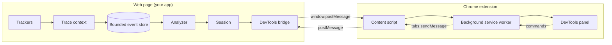
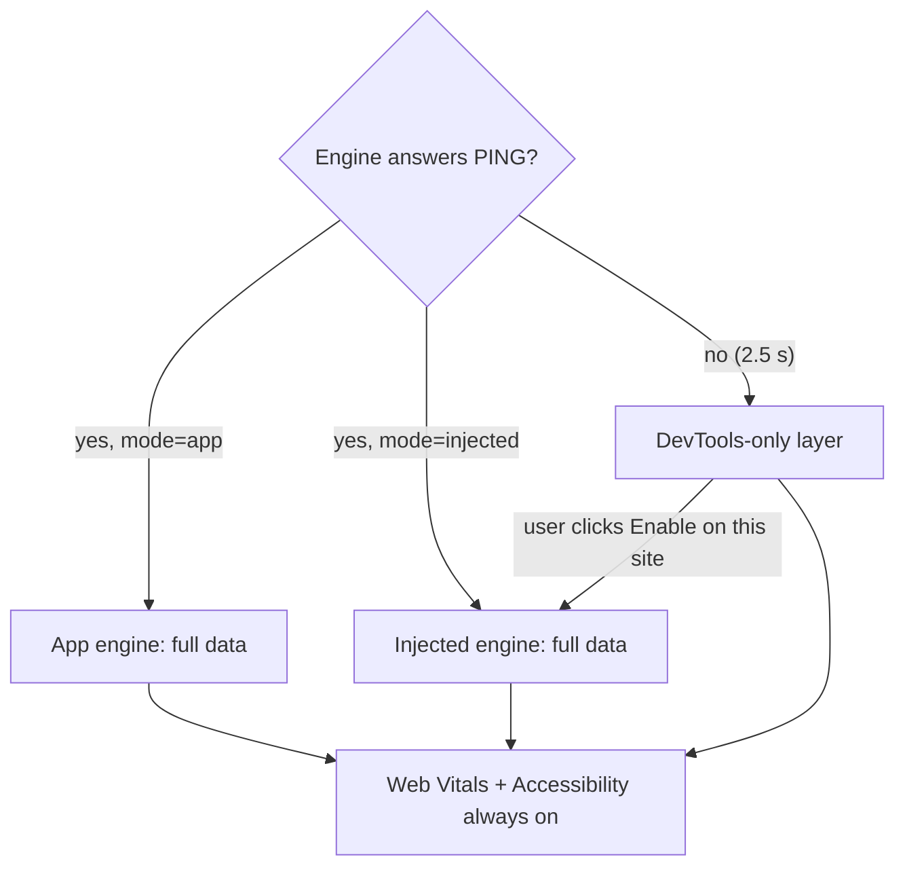

# Perf Intelligence — Architecture & Features

> Version 0.3 · Engine `core/` · Demo `demo/` · Chrome extension `extension/`

Perf Intelligence is an in-browser performance **and accessibility** diagnosis system. It records what happens when a user interacts with a web app (clicks, keystrokes, network requests, React renders, main-thread blocking), links those events into **causal traces**, and explains slow interactions in plain language, with **measured evidence** and a suggested fix, inside a Chrome DevTools panel. It also audits the live page against 89 accessibility rules (WCAG). It works on **any page**: with the engine installed in the app, injected by the extension, or in a DevTools-only mode with no engine at all.

It answers questions raw profilers leave to you:

- *Why did this click feel slow?* The handler blocked the main thread for 280 ms before the first render.
- *Which component re-renders too much?* `ResultsList` rendered 12 times per keystroke; 9 were wasted.
- *Is the network holding up the UI?* `/api/invoices` took 900 ms, and the table rendered only after it responded.
- *Are we within budget?* Interaction p75 is 240 ms against a 200 ms budget: fail.

---

## 1. System overview



| Part | Tech | Role |
|------|------|------|
| `core/` | TypeScript library, no runtime dependencies, no React dependency | Captures events, correlates traces, analyses, publishes to DevTools |
| `extension/` | Chrome MV3, vanilla JS, no build step | Transports data per tab and renders the DevTools panel |
| `demo/` | React 19 + Vite | Showcase app and on-demand generator of every performance problem |

### 1.1 Three operating modes

The panel adapts to what is available on the inspected page. A badge in the toolbar shows the current mode.

| Mode | How it starts | What runs where | Data available |
|------|---------------|-----------------|----------------|
| **App engine** | The app imports core and calls `instrumentReact()` + `initPerfEngine()` | Full engine inside the app's own bundle | Everything, plus custom budgets and custom rules in code |
| **Injected engine** | The user clicks **Enable on this site** in the panel | The extension registers a bundled copy of core (`vendor/perf-engine.inject.js`) as a MAIN-world content script at `document_start` for that origin only, then reloads the tab | Everything (traces, React renders, components) on any site, with no code changes |
| **DevTools only** | Automatic when no engine answers the handshake | The panel builds data itself: network from `chrome.devtools.network` (HAR), plus a small passive collector installed via `inspectedWindow.eval` (long animation frames, Event Timing, LCP, CLS, paint, navigation). The bundled analyzer (`vendor/perf-analyzer.mjs`) turns that into insights | Overview (limited), Insights (slow interactions, long tasks, slow/failed requests), Timeline (all lanes except renders), Network, Web Vitals, Accessibility |

The following work in **every** mode, because they come from DevTools itself rather than the engine:

- **Web Vitals:** LCP, INP, CLS, FCP, TTFB.
- **Accessibility audit.**

In DevTools-only mode, the Traces and Components views and the Renders lane show an **Enable on this site** prompt.



**Engine handoff.** Every core copy registers itself on `globalThis.__PERF_ENGINE_GLOBAL__`. If a site has injection enabled *and* ships its own engine, the app engine stops the injected one, so exactly one engine talks to the extension and no event is counted twice. In injected mode the bridge also waits until `DOMContentLoaded` before announcing itself, so an app engine that starts during page load wins cleanly.

**Permissions.** The extension ships with only `storage` and `scripting`. Site access (`optional_host_permissions`) is requested per origin, only when the user clicks **Enable on this site**, and it can be revoked from the panel's site settings or from Chrome.

**Design principles**

- **Causality at capture time.** Events are tagged with their trace when they happen. Nothing is guessed later from timestamps.
- **Evidence over heuristics.** Every insight carries the measurements that produced it; confidence is computed from that evidence.
- **Never harm the host app.** Instrumentation is defensive (it never throws into the page), SSR-safe, and costs nothing while DevTools is closed.
- **Untrusted boundary.** Everything the page sends to the extension is validated and rendered as text only.

---

## 2. Core engine (`core/`)

```
core/
├─ index.ts, session.ts        public API + session lifecycle
├─ types/                      events, insights, protocol contracts
├─ tracker/                    ui · network · render · performance (LoAF, Event Timing) · dom helpers
├─ trace/traceContext.ts       causal trace model
├─ react/instrumentReact.ts    automatic React fiber instrumentation
├─ logger/store.ts             bounded event store (pause, drop counters)
├─ analyzer/                   context · rules/* · budgets · summary · traces · engine
├─ bridge/devtoolsBridge.ts    page side of the DevTools protocol
├─ runtime/engineGlobal.ts     cross-copy registry (app ⇄ injected handoff)
├─ a11y/                       runtime accessibility audit (89 rules)
├─ inject/                     entry points for the extension bundles
├─ scripts/                    build-extension.mjs, build-a11y.mjs (esbuild → extension/vendor/)
├─ tests/  a11y/__tests__/     vitest suites        bench/ (vitest bench)
```

`extension/vendor/` holds three files generated from core and checked in, so the extension loads unpacked without a build step:

| File | What it is |
|------|------------|
| `perf-engine.inject.js` | IIFE injected into pages |
| `perf-analyzer.mjs` | ESM analyzer used by the panel in DevTools-only mode |
| `a11y-audit.js` | IIFE accessibility auditor |

### 2.1 Event capture: trackers

| Tracker | Source | Produces |
|---------|--------|----------|
| UI | Capture-phase DOM listeners: `click`, `dblclick`, `keydown`, `input`, `change`, `submit`, `pointerdown` | `ui` events with target descriptor, human label, browser `timeStamp` (for input delay) |
| Network | Patched `fetch` + `XMLHttpRequest` (idempotent install) | `network` events: sanitised URL (no query values), method, status, start/end, size, cache flag, error |
| Render | `instrumentReact()`, `<Profiler>` callback, or manual `trackRender()` | `render` events per component **instance** |
| Main thread | `PerformanceObserver('long-animation-frame')`, falling back to `longtask` | `longtask` events with blocking time and **script attribution** (which function blocked) |
| Interaction timing | `PerformanceObserver('event')`, the Event Timing API behind INP | `interaction` events split into input delay / processing / presentation delay |

High-frequency noise (`scroll`, `focus`, `blur`, `keyup`) is not captured, so it can't flood the store. Text from form fields and `contenteditable` is never read.

### 2.2 Trace / correlation model ⭐

A **trace** is one user gesture and everything it caused.

```
pointerdown ─┐ (click within 500 ms joins the same trace)
click ───────┴─► TRACE OPEN
   │  synchronous handler ........ pinned until the triggering task ends
   │  microtasks, next frames .... active until 120 ms idle (hard cap 2 s)
   │  fetch('/api/x') ............ request remembers the traceId
   ▼
response arrives ─► trace re-activated for the continuation ─► renders tagged
```

Rules that make it reliable:

- **Tag at capture.** Every event reads the active trace id when it is created. Analysis never mutates or re-tags events.
- **Slow handlers don't expire their own trace.** The idle clock starts only after the triggering task finishes.
- **Gesture joining.** `keydown→input`, `click→change/submit`, and `pointerdown→click` form one trace, not several overlapping ones.
- **Async hand-off.** A request re-activates its trace when its response arrives. If a *newer* interaction is live, the response only borrows the context for its synchronous continuation and then restores the live trace.
- **Engine work is detached.** UI that renders engine stats runs in `runDetached`, so it is never blamed on the user's click.

### 2.3 React render instrumentation ⭐

`instrumentReact()` installs (or chains onto) `__REACT_DEVTOOLS_GLOBAL_HOOK__`, the same hook React DevTools uses, and listens to every commit. No code changes in components are needed.

For each component that actually rendered in a commit, it records:

| Field | Meaning |
|-------|---------|
| `componentName`, `instanceId` | Display name plus a stable per-instance id (24 list rows are 24 instances, not one component) |
| `commitId`, `phase` | Which commit; `mount` / `update` |
| `durationMs`, `selfDurationMs` | Real render time, including children and self only (React dev builds) |
| `changedProps`, `stateChanged`, `contextChanged` | *Why* it rendered |
| `wasted` | Re-rendered with no prop, state, or context change, i.e. only because its parent rendered |
| `parentComponent` | Nearest composite ancestor |

It works with or without the React DevTools extension installed, skips bailed-out subtrees, and must be called **before `react-dom` loads** (the demo imports `./perf` first in `main.tsx`).

### 2.4 Analysis pipeline

```
events ─► buildAnalysisContext ─► rules ─► merge/dedupe ─► budgets ─► summary + trace summaries
          (group by traceId,       (10)     (interval        (6)        (score, top lists,
           render commits,                   union)                      causal spans)
           per-instance)
```

The context groups events by trace first; time windows are used only for untagged legacy events. Each event belongs to exactly one trace. Analysis is O(n log n): about 12 ms for 2k events and about 55 ms for 10k.

### 2.5 Evidence-based analyzer ⭐

Every `Insight` has:

- a **stable `id`**, anchored on the trigger or first event, so it doesn't change as a window grows;
- a **category** (rendering · network · main-thread · interaction · budget) and **severity** from the measured magnitude;
- a message, cause, and possible fix;
- **`evidence[]`**: each item is a measured value with its unit, the threshold it was compared to, the event ids behind it, and a weight;
- **confidence** computed from the evidence as a noisy-OR, `1 − Π(1 − weightᵢ)`, capped at 0.98;
- **impact** from measured durations (flagged as estimated when durations are unknown).

Severity for latency follows INP-style bands: under 100 ms low, under 200 ms medium, under 500 ms high, 500 ms and above critical. Render cascades that cost less than one frame (16 ms) are capped at medium.

**Rules**

| Rule | Detects | Key threshold |
|------|---------|---------------|
| `keystroke-render-loop` | One keystroke causing many renders | ≥ 3 renders within 120 ms of an input |
| `interaction-induced-render-burst` | A click cascading through many components | ≥ 6 renders within 160 ms |
| `interaction-render-latency` | Slow time from trigger to first render (sync work or a blocking request) | ≥ 50 ms |
| `network-blocking-render` | UI waiting on a slow request | Request ≥ 500 ms, ≥ 2 renders within 200 ms **after** the response |
| `state-thrashing` | State flipping back and forth rapidly | ≥ 4 commits from one cause, gaps ≤ 80 ms |
| `wasted-render` | Re-renders with no input change | ≥ 3 wasted renders of an instance |
| `slow-interaction` | Browser-measured latency over budget | `interactionLatencyMs` budget |
| `long-task` | Main thread blocked, with script attribution | `longTaskMs` budget, blocking time > 0 |
| `slow-component` | A single component render over one frame | `componentRenderMs` budget |
| `budget-exceeded` | Any failing budget not already covered above | Always runs last |

Rules are isolated: a throwing custom rule is logged and skipped, not fatal. Rules always scope to a trace, never to the global event list.

### 2.6 Performance budgets ⭐

| Budget | Default | Measured as |
|--------|---------|-------------|
| Interaction latency | 200 ms | p75 of Event Timing samples (INP-style) |
| Long task | 50 ms | Longest blocking main-thread task |
| Component render | 16 ms | Slowest single render (self time) |
| Renders per interaction | 25 | Max renders in one trace |
| Network request | 1000 ms | Slowest request |
| Wasted renders | 30 % | Share of renders that were wasted (needs ≥ 20 samples) |

Status is **pass**, **warn** (at 80 % of the limit or more), **fail**, or **no-data**. Budgets can be set in code (`initPerfEngine({ budgets })`), at runtime (`session.setBudgets`), or from the DevTools panel.

**Health score (0–100):** starts at 100. Each failing budget costs 12 and each warning 4. Insights cost critical 10 · high 6 · medium 3 · low 1, capped at 50 in total. Grades: **good** ≥ 90 · **needs improvement** ≥ 50 · **poor** below 50.

### 2.7 Session API

```ts
import { instrumentReact, initPerfEngine } from 'core'

instrumentReact()                               // before react-dom loads
const session = initPerfEngine({ budgets: { interactionLatencyMs: 200 } })

session.getInsights()   session.getTraces()   session.getSummary()
session.pause()  session.resume()  session.clear()  session.setBudgets({...})
session.subscribe(snapshot => …)                // after each analysis tick
session.stop()                                  // idempotent
```

All trackers default on. Everything is a no-op outside the browser. Full reference: [`CORE_API.md`](./CORE_API.md).

### 2.8 Accessibility audit ⭐

The extension and the demo present **one unified accessibility rule set: 174 rules**
(`core/a11y/catalog/unified.ts`), each with our own title, description and "how to fix", its WCAG
success criteria (level + version) and tags (best practice, Section 508, EN 301 549). Internally it
is evaluated by three open-source engines, whose 506 source rule / check ids all map into it
(89 unified rules combine several engines):

| Engine (internal) | Source ids | How it ships | Role |
|-------------------|------------|--------------|------|
| Runtime port of BarrierBreak [eslint-plugin-a11yinspect](https://github.com/BarrierBreak/eslint-plugin-a11yinspect) (MIT), `core/a11y/engine.ts` + `rules/*` | 89 rules / 227 checks | inside `vendor/a11y-audit.js` | fast first pass (10–200 ms), computed names, real visibility |
| IBM Equal Access [accessibility-checker-engine](https://github.com/IBMa/equal-access) 4.0.34 (Apache-2.0), adapter `core/a11y/ibm.ts` | 174 rule ids (173 rules + a debug rule; 162 in the `IBM_Accessibility` ruleset; 2 helper rules ignored) | `vendor/ibm-ace.js`, the official `ace.js` **unchanged** | ACT-harmonized rules incl. contrast, focus, target size, same-origin frames |
| Deque [axe-core](https://github.com/dequelabs/axe-core) 4.13.0 (MPL-2.0), adapter `core/a11y/axe.ts` | 105 rules | `vendor/axe.min.js`, **unchanged** | ACT rules incl. contrast, ARIA, shadow DOM |

No rule is hand-ported from IBM or axe: their official browser builds are vendored byte-for-byte
(with a generated header, license banners kept; `vendor.test.ts` checks it). The adapters take the
engine object as a parameter, so core has no runtime dependency on either package.

**Source result → finding (engine level).**

| Source result | kind | impact |
|---------------|------|--------|
| A11yInspect `*-error` / `*-warning` rule | error / warning | from the source severity tag (Blocker/Critical → critical, Major → major, Minor → minor, Best Practice → info) |
| IBM `VIOLATION` + `FAIL` | error | critical (IBM toolkit level 1), else major |
| IBM `VIOLATION` + `POTENTIAL` | review | major (toolkit level 1), else minor |
| IBM `RECOMMENDATION` + `FAIL` / `POTENTIAL` | warning | minor / info |
| IBM `INFORMATION` (non-pass) | warning | info |
| IBM `PASS`, `MANUAL` | dropped (`includeManual` maps MANUAL to review/info) | |
| axe `violations` / `incomplete` | error / review | critical → critical, serious → major, moderate → minor, minor → minor |
| axe `passes`, `inapplicable` | not requested | |

**"Needs review" (`kind: "review"`)** is a possible failure a person must confirm. It has its own
counts (`counts.reviews`), filter chip and neutral (indigo) style, and weighs 25% of an error in
the score (warnings 60%). Selectors: IBM results carry the live node (fallback: its XPath, resolved
through shadow roots and frames), axe `node.element` / `node.target`; both become the same unique
CSS path the A11yInspect port uses, or the XPath when no document-level selector exists. Snippets are
regenerated from the live element with the same redaction (`snippetFromMarkup` for markup-only
results); vendor message strings and message arguments are never used, except numeric contrast
ratios in `detail`.

**Unification** (`core/a11y/unify.ts`, `mergeA11yReports`, DOM-free so the panel runs it):

- every source finding → its unified rule, refined by element shape where a source rule is broader
  (e.g. IBM's "form control has a label" on a `<button>` → `button-name`);
- **one finding per element + unified rule**, keyed by element identity: each adapter records the element's per-page
  `node` key, its composed-tree `pos` and ONE canonical selector (our CSS path, or our XPath through shadow roots /
  frames), so an element described as a CSS path, an IBM XPath and an axe `host >>> inner` target is one finding with one
  selector. The same problem reported twice is collapsed by catalog policies (`catalog/unified.ts`): page-level rules on
  the top document's html/head/body are one page finding (`PAGE_RULES`); a rule that another rule on the same element
  covers folds into it (`SUBSUMED_BY`, e.g. placeholder-only label → label); the same rule on an element and its
  descendant keeps the outer (button-name, link-name, region, aria-hidden-focus) or inner (image-alt) element
  (`NESTED_POLICY`); an unlabelled icon inside an unnamed button / link folds into the control (`NESTED_INTO`); source
  rules broader than one unified rule are refined by element (`REFINE`, e.g. "role list must own listitems" on a native
  `<ul>` → list) or check (`CHECK_REFINE`, axe id-reference values → aria-valid-reference). Findings are ordered by impact,
  kind, rule, then document order; kind = most severe (error > review > warning), impact =
  most severe, count = max; the hidden `sources: [{engine, rule, check, kind}]` keeps the origin
  (exports / debugging only, never rendered). Unmapped source ids (after an engine upgrade) land in a
  fallback rule "other";
- filtered by the **standard** (`core/a11y/wcag.ts`): WCAG 2.0 / 2.1 / 2.2 × A / AA / AAA, or the
  Section 508 (= WCAG 2.0 AA) / EN 301 549 (= WCAG 2.1 AA) profiles, plus "best practices" and "needs
  review" toggles; 4.1.1 Parsing counts as obsolete in 2.2 (best practice). Engines are run for the
  standard too: axe `runOnly` cumulative tags (2.2 AA = `wcag2a wcag2aa wcag21a wcag21aa wcag22a
  wcag22aa` [+ `best-practice` / `section508` / `EN-301-549`]), IBM ruleset `WCAG_2_0/2_1/2_2`
  (or `IBM_Accessibility` with best practices / for 508 / EN), A11yInspect by criterion;
- counts and score recomputed; `rulesChecked` (unified rules whose sources ran) feeds the coverage
  views: `criteriaCoverage` (every success criterion of the standard: failing / needs review /
  passed automated checks / no automated check; static table of all 87 WCAG 2.0–2.2 criteria) and
  `rulesCoverage` (every unified rule: failing / review / passed / not checked).

**Loading without clobbering page globals** (`core/a11y/loaders.ts`): `ace.js` declares a top-level
`var ace`; the wrapper evaluates it inside a function, so it installs `window.__PERF_INTEL_ACE__`
and never creates or overwrites `window.ace`. `axe.min.js` is UMD (AMD `define`, `module.exports`,
`window.axe`); the wrapper shadows `define`/`module`/`exports`, captures the new `window.axe` into
`window.__PERF_INTEL_AXE__` and restores the page's own `axe` (or deletes the property). Verified in
real Chrome with page-owned `ace`/`axe` globals and an AMD loader stub.

- **Privacy.** Form values, input and `contenteditable` text are never read into findings. The row preview `name`
  (≤60 chars of aria name / alt / text) is empty for fields, options, anything inside or containing a field or
  contenteditable, the page root and large containers.
- **Speed** (real Chrome, full page): A11yInspect 8–180 ms; axe 0.1–7 s; IBM 0.05–34 s
  (example.com 48 ms, w3.org/WAI 1.5 s, Wikipedia article 28–34 s). IBM's `check()` is synchronous
  inside the page (its promise resolves at the end), so it runs last; the panel shows fast results
  first, elapsed time and a Cancel.
- **Where it runs.** The DevTools panel (all modes), the demo card (lazy chunks), and apps / CI via
  core: `runA11yAudit(root?)`, `runIbmAudit(ace, root?, opts)`, `runAxeAudit(axe, root?, opts)`,
  `mergeA11yReports(reports, { standard })`. All named exports: an app using only `initPerfEngine`
  ships none of it.

---

## 3. Page ⇄ extension transport

Full contract: [`PROTOCOL.md`](./PROTOCOL.md).

| Direction | Messages |
|-----------|----------|
| Page → extension | `HELLO` (engine present, config) · `SNAPSHOT` (insights, events, traces, summary, budgets) · `RESET` |
| Extension → page | `PING` · `ATTACH` / `DETACH` · `REQUEST_SNAPSHOT` · `CLEAR` · `PAUSE` / `RESUME` · `SET_BUDGETS` |

- **Zero overhead when DevTools is closed.** The page streams snapshots only between `ATTACH` (first panel opens) and `DETACH` (last panel closes), throttled to about 1 s and sent only when data changed.
- **Engine detection.** The panel sends `PING`; no `HELLO` within about 2.5 s means "No engine on this page".
- **Resilience.** The MV3 service worker can be stopped at any time. Background keeps per-tab state in memory and in `chrome.storage.session` (with a global LRU budget) and restores it on restart. Orphaned streams are detached automatically. Tab state resets on navigation and on tab close.
- **Security.** Only top-frame messages are accepted. Every payload is validated and capped. The panel never uses `innerHTML` with page data. Permissions are `storage` + `scripting`; site access is granted per origin only when the user enables injection.

**Injection control** (panel ⇄ background):

| Message | Effect |
|---------|--------|
| `INJECTION_STATUS_REQUEST` | Background replies `INJECTION_STATUS { origin, enabled, granted }` |
| `ENABLE_INJECTION` | Panel first requests host permission for the origin (user click); background then registers the injected engine and reloads the tab |
| `DISABLE_INJECTION` | Background unregisters it, optionally removes the permission, and reloads the tab |

Revoking a site's permission in Chrome unregisters its script automatically.

---

## 4. DevTools panel (`extension/devtools/`) ⭐

The panel follows the macOS / Xcode Instruments style: system font, 4/8 pt spacing, hairline separators, a translucent toolbar, one accent color plus semantic status colors. It follows the DevTools light/dark theme and adapts from about 420 px wide up to full width.

| View | What it shows |
|------|---------------|
| **Overview** | Health score ring and grade; KPI tiles (interaction p75/worst, renders and wasted %, long tasks and blocking ms, requests and failures, insights by severity); budgets with pass/warn/fail bars; top components; top requests; activity sparkline |
| **Insights** | Sortable, filterable, keyboard-navigable list. Detail pane: cause, fix, confidence meter, impact, the **evidence list** with threshold bars, "seen N×" history, and **Show in timeline** |
| **Timeline** | Swimlanes for Interactions · Main thread · Network · Renders (per component, wasted renders hatched). Zoom, pan, brush-to-zoom, and a trace strip. Draws **causal links** from the interaction to long tasks, requests, and render commits, and highlights evidence events |
| **Traces** | Table of traces (trigger, duration, latency, renders, requests, blocking ms), each with a **waterfall** of its causal span tree and linked insights |
| **Components** | Per-component renders, mounts, wasted %, total/avg/max ms |
| **Network** | Requests with method, status, duration bar, size, initiator, and trace link |
| **Accessibility** | One unified rule set (174 rules; engines never named). Score ring, error / needs-review / warning counts by impact. **Standard** selector (WCAG 2.0 / 2.1 / 2.2 × A / AA / AAA, Section 508, EN 301 549) with **Best practices** and **Needs review** toggles. Sub-views: **Issues** (filters: kind incl. Needs review, impact, level, search; grouped **by rule** or **by WCAG criterion**; detail with our own how-to-fix, W3C "Understanding" links only, snippet, **Inspect in Elements**, **Highlight on page**), **WCAG** (every criterion of the standard: failing / needs review / passed automated / no automated check) and **Rules** (every unified rule: failing / review / passed / not checked). **Run audit** shows the fast results at once, then refines the same list while the other engines run ("Scanning page… 2.3 s", **Cancel**); order stays stable while refining and settles into severity order once at the end. **Live** re-audits when the DOM changes. Footer: **Open-source credits** (opens `THIRD_PARTY_NOTICES.txt`) |

**What each view shows per mode**

| View | App / Injected engine | DevTools only |
|------|-----------------------|---------------|
| Overview | Full, with Web Vitals card | Web Vitals, network and main-thread KPIs; render KPIs show "—" (needs engine); score marked "limited data" |
| Insights | All 10 rules | Slow interactions, long tasks, slow/failed requests |
| Timeline | All lanes + causal links | Interactions, main thread, network; Renders lane shows "Needs engine" |
| Traces | Full | Enable-on-this-site prompt |
| Components | Full | Enable-on-this-site prompt |
| Network | Engine requests | Every request from DevTools (HAR) |
| Accessibility | Full | Full |

**Toolbar:**

- mode badge: *App engine* / *Injected engine* / *DevTools only · limited*; click it for site settings (Enable / Disable on this site);
- Record/Pause and Clear;
- Export and Import JSON (read-only replay mode; exports include vitals and accessibility results);
- Budgets editor (saved and re-applied automatically).

**Keyboard:**

- `1`–`7` switch views;
- `↑/↓` + `Enter` navigate lists;
- `/` search, `Esc` clear search;
- `Space` pause.

**Status:** Connected · Recording · Paused · Disconnected · Page navigated. When no engine answers, the panel falls back to DevTools-only mode instead of a dead end, with a banner offering **Enable on this site** or **How to install in your app**.

`extension/dev/preview.html` renders the panel with mock data in a normal browser tab (`?theme=dark|light`, `?state=noengine`), so you can work on the UI without installing the extension.

---

## 5. Demo app (`demo/`)

**Northstar** has three tabs: **Workspace** · **Scenario Lab** · **About**. It uses Apple-style light/dark design and works from 360 px to wide screens. A mock API (`/api/messages`, `/api/invoices`, `/api/slow?ms=`, `/api/error`) is served by Vite in both dev and preview.

- **Workspace:** a realistic inbox (messages loaded over the network, tasks, filters, search) built from many small components. It is the *well-behaved* control surface.
- **Scenario Lab:** one card per rule. Each card has a Run button, a parameter where useful, a description of "what DevTools should show", a live **Detected** badge, and a **Fixed version** toggle that proves the fix removes the insight. "Run all" executes every card in sequence.

| Scenario | Triggers | The fix it demonstrates |
|----------|----------|-------------------------|
| Render burst | `interaction-induced-render-burst` | `memo` rows, no effect-driven state |
| Keystroke loop | `keystroke-render-loop` | `useDeferredValue` / debounce |
| Slow handler | `interaction-render-latency`, `slow-interaction`, `long-task` | `startTransition` + chunked work |
| Slow network | `network-blocking-render` | Prefetch + cache |
| State thrash | `state-thrashing` | Single derived state |
| Wasted renders | `wasted-render` | `React.memo` + stable props |
| Slow component | `slow-component` | Cheaper render |
| Request failure | `budget-exceeded` / network | Handling failed and slow requests |
| Healthy control | *nothing* | Proves no false positives |
| Accessibility issues | Accessibility findings (missing alt, unnamed icon button, unlabeled input, duplicate ids, skipped heading level, "click here" links, table without headers) | Accessible markup; the card's badge audits its own subtree with `runA11yAudit` |

Deliberate performance problems exist only in `demo/src/scenarios/` and are marked `INTENTIONAL`.

---

## 6. Quality: tests & benchmarks ⭐

- **814 vitest tests** (`npm test` runs both suites):
  - **201 engine tests** in `core/tests/`: trace context, context building (no mutation), every rule with positive *and* negative fixtures, insight id stability, evidence and confidence, severity bands, budgets and p75, score, span parenting, engine merge and rule isolation, session lifecycle, network sanitising, bridge protocol (jsdom), React instrumentation on fiber trees, engine handoff between copies, React DevTools coexistence (checked against the real `react-devtools-core` backend), plus a regression suite for every bug found in review.
  - **accessibility tests** in `core/a11y/__tests__/`: every one of the 227 ported checks has a fixture that triggers it (enforced by a coverage test against the original rule sources), plus accessible-name computation, hidden-subtree skipping, selector uniqueness, PII redaction, and a speed and linear-scaling guard; the IBM and axe adapters run the **real** vendored engines in jsdom (`ibm.test.ts`, `axe.test.ts`), `unified-coverage.test.ts` checks every source id of all three engines maps to exactly one unified rule, `unify.test.ts` the merge / standards / coverage views, `vendor.test.ts` that the vendored files are unchanged copies.
- **Performance guard:** `perf-budget.test.ts` fails if analysing 2k events takes more than 50 ms (median of 5 runs), and checks that cost grows roughly linearly with event count.
- **Benchmarks** (`npm run bench`): `analyzeEvents` at 2k/10k/50k events (about 12 / 55 / 260 ms), context build, summary, trace summaries, React commit walk over 5k fibers (about 4 ms), store throughput.
- **End-to-end checks** (real Chrome, including the **real DevTools panel**):
  - every scenario detected, every "fixed version" clean, healthy control has zero insights;
  - extension protocol checks pass;
  - all three modes verified on the demo and on a plain page with no engine (mode badge, Web Vitals, insights, network, Accessibility tab, Inspect in Elements, export/import);
  - the engine handoff sends exactly one session when the app engine and injection are both active.
- **Bundle sizes:** `perf-engine.inject.js` 68 KiB, `perf-analyzer.mjs` 40 KiB, `a11y-audit.js` 189 KiB (A11yInspect port + adapters + unified catalog + merge), `a11y-rules.mjs` 69 KiB (panel: catalog, WCAG table, merge), `ibm-ace.js` 670 KiB and `axe.min.js` 567 KiB (vendored, injected only when the Accessibility tab audits). Demo main bundle 319 kB (was 427 kB before the audit became a lazy chunk; engines are separate lazy chunks). Core is tree-shakeable: an app that only uses `initPerfEngine` doesn't ship the a11y code.

---

## 7. Getting started

```sh
cd core && npm install && npm test          # engine + tests
cd demo && npm install && npm run dev       # open the printed URL
```

1. Open `chrome://extensions`, turn on **Developer mode**, click **Load unpacked**, and select the `extension/` folder.
2. Open the demo, then DevTools, then the **Perf Intelligence** tab.
3. Go to **Scenario Lab**, press **Run**, and watch the insight appear with its evidence and timeline.

**On any other site:**

1. Open DevTools and go to **Perf Intelligence**. It starts in *DevTools only* mode, with Web Vitals, network, main thread, interactions and Accessibility.
2. For full data, click **Enable on this site**, approve the permission, and the page reloads with the injected engine.

**In your own app** (best fidelity, custom budgets and rules). The package isn't on npm yet, so use a local `file:` dependency to `core/`:

```ts
// entry file, imported before react-dom
import { instrumentReact, initPerfEngine } from 'frontend-performance-intelligence-engine'
instrumentReact()
initPerfEngine()
```

**Accessibility in code or CI:**

```ts
import { runA11yAudit } from 'frontend-performance-intelligence-engine'
const report = runA11yAudit(document)   // findings with WCAG ids, selectors, score
```

After changing `core/`, regenerate the extension bundles with `cd core && npm run build:extension`.

---

## 8. Known limitations

- Render durations are real only in React **development** or profiling builds; in production they are 0, so `slow-component` doesn't fire.
- Slow typing (about 70 ms per key) yields one keystroke-loop insight per keystroke.
- Response-body continuations (`await res.json()`) are not propagated if a newer interaction is already live.
- The in-memory store holds the last 2000 events; there is no persisted history across page loads (use Export).
- The content script runs in the top frame only, so apps inside iframes are not inspected.
- DevTools-only mode can't see React renders or build causal traces; enable injection for those.
- The built-in first pass doesn't enter shadow DOM or iframes (the other engines check open shadow roots; IBM also same-origin frames). Findings inside shadow trees carry an XPath instead of a CSS selector. Like any automated checker, the audit finds a subset of WCAG issues; manual testing (keyboard, screen reader) is still needed.
- The IBM engine scans synchronously inside the page: on very large pages (e.g. a long Wikipedia article, ~30 s) the page is busy until it finishes. Cancel discards the result but cannot interrupt the running scan.
- Apps built with core 0.2 or earlier don't know the handoff registry; with injection also enabled on such a site, two engines would run.
